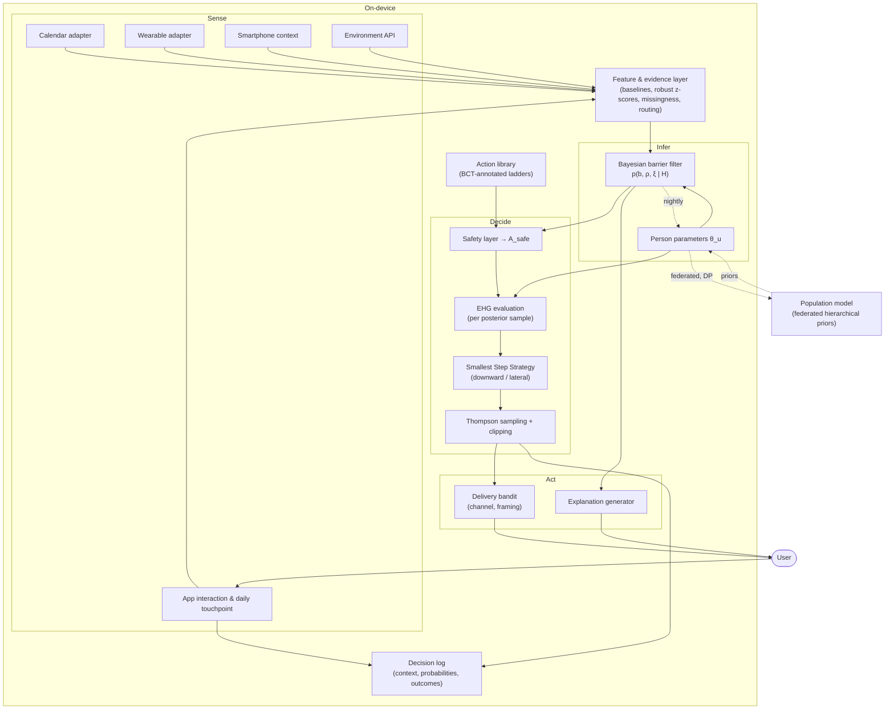
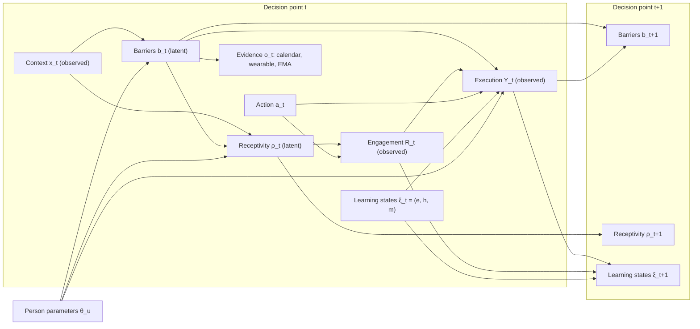

# 3 Architecture and Development of the Behaviour Understanding Engine

## 3.1 Design Requirements

The architecture developed in this chapter is derived from the research gap identified in Section 2.12 and from the hypotheses formulated in Section 1.3.2. This section makes the derivation explicit by stating the requirements the engine must satisfy. Each requirement has a source in the literature or the hypotheses, is assigned to the part of the thesis where it is addressed, and has an acceptance criterion against which the evaluation in Chapter 5 can assess it. Stating the requirements first serves two purposes. It disciplines the design: every architectural element must answer to at least one requirement, and every requirement must be met by at least one element. It also makes the evaluation falsifiable, because each requirement translates into a measurable property.

### 3.1.1 Functional Requirements

Functional requirements describe what the engine must *do*. They are grouped by the three capabilities named in the thesis objective (Section 1.3): sensing barriers, selecting the smallest effective step, and learning the person.

**Sensing barriers.**

- **FR1 — Latent barrier inference.** The engine shall represent the user's momentary capability, opportunity and motivation barriers as latent variables and infer them from heterogeneous evidence, including calendar, wearable and smartphone data. *Source:* COM-B (Section 2.2); the observation that existing JITAIs tailor almost exclusively on observed variables (Section 2.6.3); hypothesis H1.
- **FR2 — Outcomes as evidence.** The engine shall treat engagement with and execution of its own proposals as evidence about the user's latent state, and shall apportion non-execution among competing explanations. *Source:* explaining away in Bayesian networks (Section 2.11.4); hypothesis H3.
- **FR3 — Receptivity modelling.** The engine shall estimate the probability that a prompt will be attended to, and shall withhold prompts at moments of low receptivity. *Source:* receptivity research (Section 2.7); JITAI framework (Section 2.6.1).

**Selecting the smallest effective step.**

- **FR4 — Value-based action selection.** The engine shall select actions by maximising an explicit objective that combines the expected benefit of an action with its probability of execution. *Source:* thesis objective; contrast with engagement-optimising algorithms (Section 2.5.2).
- **FR5 — Dose adaptation.** The engine shall be able to scale the requested behaviour down when execution is unlikely and up again when it becomes likely. *Source:* Fogg Behaviour Model, shaping and graded tasks (Section 2.4); hypothesis H2.
- **FR6 — Cross-domain flexibility.** The engine shall be able to propose actions from health domains other than the focal one when this yields a higher expected gain, subject to the user's focus preferences. *Source:* Section 3.3.7; multiple health behaviour change research.
- **FR7 — Long-term value.** The objective shall account for the contribution of executed actions to habit formation and self-efficacy, not only for their immediate health effect. *Source:* habit theory (Section 2.1.3); Social Cognitive Theory (Section 2.1.1).

**Learning the person.**

- **FR8 — Online personalisation with cold start.** The engine shall learn person-specific parameters online from the user's own data, starting from a population model so that it is useful from the first day. *Source:* deployed mHealth bandits (Section 2.9.3).
- **FR9 — Progression.** The engine shall detect consolidation of behaviour and progress the user towards guideline-consistent doses as habits strengthen. *Source:* shaping (Section 2.4.2); habit theory.
- **FR10 — Standardised description.** Every action shall be described in terms of the BCT Taxonomy v1 and the Behaviour Change Wheel, so that the engine's behaviour can be reported and replicated. *Source:* Section 2.3.

**Operating across sensing configurations.**

- **FR11 — Channel agnosticism.** Apart from the app itself, no data channel shall be mandatory. The engine shall operate with any subset of channels, including self-report only and passive sensing only, and the quality of its decisions shall degrade gracefully as channels are withdrawn. *Source:* heterogeneity of users' devices and preferences; equity (Section 3.7.4); the coach analogy of Section 3.2.4.

### 3.1.2 Non-Functional Requirements

Non-functional requirements describe *how* the engine must behave. They constrain the space of acceptable designs.

- **NFR1 — Safety.** The engine shall never propose an action that is contraindicated for the user's current health state. Safety constraints shall take precedence over the objective.
- **NFR2 — Autonomy and non-manipulation.** Goals shall be owned by the user. Inferred vulnerabilities shall only be used to reduce demands, never to increase persuasive pressure.
- **NFR3 — Privacy.** The engine shall minimise the data it processes, keep raw data on the device by default, and comply with the GDPR's provisions for special categories of data.
- **NFR4 — Interpretability.** The engine's beliefs and decisions shall be explainable in terms of theory-grounded constructs that users and researchers can understand.
- **NFR5 — Causal analysability.** The data generated by the engine shall support unbiased estimation of causal excursion effects, which requires logged selection probabilities and positivity.
- **NFR6 — Low burden.** The engine shall limit prompt frequency and self-report demands, and shall request self-report only when it is expected to improve decisions.
- **NFR7 — Robustness.** The engine shall degrade gracefully under missing data, sensor failure and withdrawn consent, falling back to conservative behaviour rather than failing.
- **NFR8 — Computational feasibility.** Inference and decision-making shall be feasible on a smartphone within the latency required by just-in-time delivery, i.e. within seconds.
- **NFR9 — Fairness.** The engine's accuracy and benefit shall be monitored across user groups, and structural disadvantages in its data sources shall be mitigated.
- **NFR10 — Engagement integrity.** Engagement features shall reinforce success experiences and shall not create failure experiences, artificial urgency or competition for attention. Engagement shall never be an optimisation target in its own right.

### 3.1.3 Traceability

Table 3.1 maps each requirement to the architectural elements that address it and to the acceptance criterion used in the evaluation.

**Table 3.1.** Requirements traceability.

| Req. | Addressed in | Acceptance criterion (Chapter 5) |
|---|---|---|
| FR1 | 3.4, 3.6, 4.1–4.4 | Barrier posteriors are calibrated against simulated ground truth (coverage of credible intervals); execution prediction improves over a context-only model (H1) |
| FR2 | 3.4.2, 4.3, 4.5 | Faster convergence of person parameters than with outcome-as-reward only (H3) |
| FR3 | 3.3.2, 3.4.5 | Higher engagement rate per prompt than time-randomised prompting |
| FR4 | 3.3, 4.7 | Higher cumulative realised benefit than baselines (H0) |
| FR5 | 3.3.5, 3.5.2, 4.6 | Higher long-run execution rate and benefit than fixed-dose prompting (H2) |
| FR6 | 3.3.7, 3.5.3 | Lateral steps chosen predominantly in states with reducible barriers; focus constraint respected |
| FR7 | 3.3.3, 4.8 | Simulated habit strength grows faster than under benefit-only objectives |
| FR8 | 4.2, 4.7 | Regret within the first two weeks below that of non-pooled learning |
| FR9 | 4.8 | Mean proposed dose increases with simulated habit strength |
| FR10 | 3.5 | Every action in the library has a complete BCTTv1/BCW annotation |
| FR11 | 3.2.4, 3.6.6 | Engine outperforms a fixed-schedule baseline in every reference profile P0–P3; performance ordered by information content of the profile |
| NFR1 | 3.7.1 | Zero contraindicated proposals in safety scenarios |
| NFR2 | 3.4.1, 3.5.5, 3.7.2 | No persuasive templates selectable under high-load states; goals never modified by the engine |
| NFR3 | 3.7.3 | Raw data never leave the device in the reference architecture |
| NFR4 | 3.4, 3.7.2 | Every decision accompanied by a generated, construct-level rationale |
| NFR5 | 3.7.5 | Selection probabilities logged and clipped; excursion effects estimable from logs |
| NFR6 | 3.3.4, 3.5.4, 3.7.1 | Prompt rate below cap; EMA requests only when value of information exceeds burden |
| NFR7 | 3.6.7, 3.7.5 | Bounded performance loss under simulated channel dropout |
| NFR8 | 4.9 | Decision latency below one second on reference hardware |
| NFR9 | 3.7.4 | Calibration and benefit reported per simulated subgroup |
| NFR10 | 3.8 | No failure states, urgency messages or engagement targets in any element; engagement monitored only |


## 3.2 System Overview: The Sense–Infer–Decide–Act–Learn Loop

The Behaviour Understanding Engine is organised as a closed loop of five stages that is executed at every decision point: *sense* the person's context, *infer* their latent state, *decide* on an action, *act* by delivering it, and *learn* from the outcome. The loop is closed because the outcome of each action becomes evidence for the next inference. This feedback distinguishes a behaviour *understanding* system from a behaviour *tracking* system: the engine's proposals are not only interventions but also probes, and every probe tells it something about the person. This section gives an overview of the stages, the components that implement them and the time scales on which they operate. Sections 3.3–3.7 and Chapter 4 then specify each component in detail.

### 3.2.1 The Five Stages

**Sense.** Data adapters collect raw signals from the calendar, the wearable, the smartphone, environmental services and the app itself. They transform these signals on the device into the features listed in Table 3.14, timestamped with both event time and arrival time. Each feature is routed according to its role: as a causal driver $\mathbf{w}_t$ of barrier baselines, as evidence $\mathbf{o}_t$, as context $\mathbf{x}_t$, or as an outcome $(R_t, Y_t)$ (Section 3.6). Which adapters are active depends on the user's sensing configuration. Apart from the app itself, every channel is optional, and the daily touchpoint, a brief coach-like check-in, can replace passive sensing as the primary source of evidence (Section 3.2.4).

**Infer.** The inference engine maintains the joint posterior $p(\mathbf{z}_t, \boldsymbol\theta_u \mid \mathcal{H}_t)$ over the latent state $\mathbf{z}_t = (\mathbf{b}_t, \rho_t, \boldsymbol\xi_t)$ and the person parameters. The update follows the predict–update cycle of Bayesian filtering (Equation 2.6). The posterior is propagated forward through the barrier dynamics (Equation 3.20), then conditioned on the new evidence and on the outcome of the previous action. The output is a set of posterior samples that represent the engine's current understanding of the person, including its uncertainty (Sections 3.4, 4.1–4.4).

**Decide.** The decision engine first constructs the safe action set $\mathcal{A}^{\text{safe}}_t$ (Equation 3.30). It then evaluates the Expected Health Gain of every remaining action on each posterior sample (Equations 3.10 and 3.17). It applies the Smallest Step Strategy, which covers both downward and lateral steps, and selects an action by Thompson sampling (Sections 3.3, 4.6, 4.7). The null action is always a candidate. When it wins, the engine stays silent, and silence is a decision like any other.

**Act.** The delivery component chooses a channel and a framing for the selected action, using the delivery bandit of Section 3.5.5. It renders the message from the action's templates and delivers it. On request, it attaches a plain-language rationale generated from the posterior's dominant barriers (Section 3.7.2).

**Learn.** After the execution window has closed, the outcome observations are assembled: engagement $R_t$, verified or self-reported execution $\hat{Y}_t$, and any "why not?" response. They are passed back to the inference engine as evidence. The learning-history states $\boldsymbol\xi_t$ are updated in expectation (Section 3.4.6), and the person parameters $\boldsymbol\theta_u$ are updated within the hierarchical model (Sections 4.2, 4.5).

### 3.2.2 Components and Data Flow

Figure 3.1 shows the components and the flow of information between them.

**Figure 3.1.** Architecture of the Behaviour Understanding Engine. Solid arrows denote the fast decision loop; dashed arrows denote slow learning loops.



Three design decisions are visible in the figure. First, *everything except the population model runs on the device*. This is what makes the privacy commitments of Section 3.7.3 feasible. Second, *the action library is data, not code*. Behavioural scientists curate it as declarative records (Section 3.5.6), and the decision engine is agnostic to its contents. Third, *the decision log is a first-class component*. It records the full vector of selection probabilities at every decision point, so that the engine's operation can be analysed as a micro-randomised trial at any time (Section 3.7.5).

### 3.2.3 Decision Points and Triggers

A decision point is a moment at which the engine considers intervening. Decision points are generated by two kinds of trigger.

- **Scheduled triggers** are tied to the user's anchors, for example shortly after the anchor "after lunch". They guarantee that every anchored behaviour receives at least one opportunity per day.
- **Contextual triggers** fire when the context suggests an opportune moment. Examples are a calendar gap that is about to open, a detected transition from sitting to standing, the end of a prolonged sedentary bout, or the arrival of new wearable data that substantially change the barrier posterior.

Every candidate decision point first passes the availability check $I_t$. Contextual triggers are additionally rate-limited, so that the number of decision points per day remains within the range for which the burden model is calibrated. The reference configuration uses three to eight decision points per day, which is comparable to the five daily decision points of HeartSteps (Klasnja et al., 2019). Because the null action is always available, a decision point does not imply a prompt. In the reference configuration, the engine typically delivers between one and three prompts per day.

### 3.2.4 Sensing Configurations and the Daily Touchpoint

The architecture so far may suggest that the engine depends on a rich sensor infrastructure. It does not, and it must not. Users differ in what they are willing and able to share. Some own no wearable. Some do not keep a digital calendar, or do not want an app to read it. Others will gladly connect every device they own but have no patience for daily questions. An engine that functions only with one particular combination of data sources excludes a large part of its intended population, and it tends to exclude precisely those with fewer digital resources (Section 3.7.4). The design therefore follows a principle of **channel agnosticism**: *apart from the app itself, no data channel is mandatory*. The engine operates on whatever subset of channels a user provides, and the quality of its understanding grows with the information available to it.

There are two complementary routes to understanding a person's state, and a good human coach uses both. The coach can *ask*, by calling or stopping by for a brief conversation. Or the coach can *observe*, by noticing that the client looks tired or that the week is packed with appointments. In the engine, asking corresponds to brief self-report in a daily conversation. Observing corresponds to passive sensing through the smartphone, the wearable and the calendar. Formally, each user $u$ has a *sensing configuration* $\mathcal{C}_u$, the set of consented channels. The Bayesian filter includes the observation models of exactly those channels in $\mathcal{C}_u$. Barriers without an informative channel fall back to their hierarchical prior and are updated only through execution outcomes. The architecture is otherwise unchanged, and a user can change the configuration at any time without loss of the model learned so far.

Four reference profiles span the space of configurations (Table 3.2).

**Table 3.2.** Reference sensing profiles and the primary evidence available for each barrier.

| Profile | Channels | $b^{\text{fat}}$ | $b^{\text{load}}$ | $b^{\text{time}}$ / $\Phi_t$ | $b^{\text{env}}$ | $b^{\text{soc}}$ | $b^{\text{mot}}$ | Execution $Y_t$ |
|---|---|---|---|---|---|---|---|---|
| **P0 App only** | App interaction, environment API | Prior, outcomes | Prior, outcomes | Prior, outcomes | Weather | Prior | Engagement, outcomes | One-tap confirmation |
| **P1 Coach** | P0 + daily touchpoint with questions | Energy item | Stress item | Time-pressure item; self-reported time windows | Weather | Optional item | Motivation item | Confirmation in touchpoint |
| **P2 Sensor** | P0 + smartphone, wearable, calendar; touchpoint without questions | Sleep, nocturnal HRV, RHR | Daytime HRV, phone fragmentation, meeting density | Calendar density, free windows | Weather, location type | Calendar event types | Engagement, miss patterns | Accelerometer (activity classes) |
| **P3 Full** | P1 ∪ P2 | Sensors + item (VOI-selected) | Sensors + item | Calendar + item | Weather, location type | Calendar + item | Item + patterns | Sensor + confirmation |

The common element of all profiles is the **daily touchpoint**: one short, regular interaction per day, at a time the user chooses. It corresponds to the moment at which a coach calls. It has two parts.

- **The listening part** consists of zero to $n_{\max}$ brief questions. The user sets $n_{\max}$. Within that limit, the engine selects the questions with the highest value of information (Section 3.6.6). In profile P1, this part is the primary source of evidence about the day's barriers. In profile P2, the user sets $n_{\max} = 0$ and the part is skipped entirely. In profile P3, questions are asked only when the sensors leave a decision-relevant uncertainty.
- **The advising part** is present in every profile. It is a brief daily plan: the recommended action, its time window and a pre-agreed smaller fallback step for the case that the day turns out harder than expected. Formally, it is a preparatory action (Section 3.5.4) that is delivered at a fixed decision point.

For a user who relies entirely on sensors, the touchpoint is therefore a *briefing* without questions: "Short night and a full calendar, so today: a 10-minute walk at 12:30, or two minutes after your last meeting if that slot disappears." For a user without sensors, it is a *conversation* of about thirty seconds whose answers lead to the same kind of plan. For a user with neither questions nor sensors (P0), the engine still functions. It learns from engagement and execution outcomes alone, starting from the population model. It is the least informed variant, but it already exceeds a fixed reminder schedule in one respect: it learns from every outcome.

Channel agnosticism has a further consequence that matters for the thesis. The relative value of asking and observing becomes an empirical question that the architecture can answer. How much expected health gain does a wearable add to a thirty-second daily conversation? Can a calendar substitute for a question about time pressure? The engine can quantify the expected value of an additional channel from its own posterior, as the expected improvement in decisions if the channel's observations were available. When this value is high and persistent, the engine may mention the option to the user once, but it never makes it a condition of support. The comparison of profiles is part of the simulation study (Section 5.5).

### 3.2.5 Three Time Scales of Learning

The loop described above is the *fast* loop, executed at each decision point within seconds. Two slower loops operate alongside it, corresponding to the layers of the human model (Table 3.6).

**Table 3.3.** Time scales of the engine.

| Loop | Frequency | Operations | Human-model layer |
|---|---|---|---|
| Fast (decision) | 3–8 times per day | Filter update with new evidence; safe-set construction; EHG evaluation; action selection; delivery | L3 (momentary states) |
| Slow (consolidation) | Nightly | Integration of late-arriving wearable data (fixed-lag smoothing); expected-value update of $e_t$, $h_{c,t}$, $m_t$; person-parameter update; recomputation of personal baselines and $\nu_{b_k}$ | L2, L1 |
| Very slow (population) | Weekly | Federated update of hierarchical priors; review of ladder progression; monitoring of safety and fairness indicators | L1 (via priors) |

The separation keeps the fast loop computationally light. Within a day, person parameters are held fixed, and only the low-dimensional momentary state is filtered. Expensive operations, such as updating the full parameter posterior, are deferred to the nightly loop, when the device is typically idle and charging.

### 3.2.6 The Decision Cycle in Outline

The fast loop can be summarised in pseudocode. The complete algorithm, including the inference routines and the Smallest Step Strategy, is given in Section 4.9.

```text
on decision point t:
    if not available(I_t):                       # driving, asleep, quiet hours, DND
        return
    evidence ← collect_new_features(since last update)
    posterior ← filter_update(posterior, evidence, outcome of a_{t-1})   # predict + update
    A_safe ← safety_filter(A, posterior, constraints)                     # Eq. 3.30
    for each posterior sample s = 1..S:
        for each a in A_safe:
            EHG[s, a] ← P_s(a) · B̃_s(a) − ρ_s ℓ_s − κ_t                 # Eqs. 3.10, 3.17
    a_t ← thompson_select(EHG, clip = [π_lo, π_hi])                      # Section 4.7
    log(t, context, posterior summary, selection probabilities, a_t)
    if a_t ≠ a_∅:
        deliver(a_t, delivery_bandit(a_t, posterior), rationale(posterior))
    schedule outcome collection at end of execution window
```

Each line of the pseudocode corresponds to a component specified in this chapter or in the next. The cycle makes the thesis's central idea operational. The engine does not ask *"how do we get this person to walk 30 minutes?"*. It asks, at every opportunity, *"given everything we believe about this person right now, which step — if any — has the greatest expected value?"*. And it uses the answer to that question to understand the person better for the next one.


## 3.3 The Expected Health Gain Framework

This section develops the Expected Health Gain (EHG) from the compact criterion introduced in Equation (1.1) into a fully specified decision objective. It answers RQ1 by defining the two factors of the EHG — the expected benefit of an executed action and the probability that the action is executed — and by making their dependence on receptivity, latent barriers and the person's learning history explicit. The section closes with three analytical results that characterise the behaviour of an EHG-maximising policy and that motivate the Smallest Step Strategy developed algorithmically in Section 4.6.

### 3.3.1 Decision Problem and Outcome Structure

At each decision point $t$, the engine observes context $\mathbf{x}_t$, holds a posterior belief $p(\rho_t, \mathbf{b}_t, \boldsymbol\theta \mid \mathcal{H}_t)$ over the user's latent state and parameters, and selects an action $a_t \in \mathcal{A}$. The action space consists of the null action $a_\varnothing$ and of proposals $a = (c, d)$, where $c$ indexes a behavioural class (e.g. walking, mobility exercise, wind-down routine) and $d \in \{1, \dots, D_c\}$ a dose level on the class-specific ladder. Each dose level is associated with a physical quantity $\tau_c(d)$ (e.g. minutes of walking) and a dimensionless *difficulty* $g_c(d)$, which is monotonically increasing in $d$; in this thesis, difficulty is taken to be logarithmic in the physical quantity, $g_c(d) = \log\!\big(1 + \tau_c(d)/\tau_c^{0}\big)$ with a class-specific reference quantity $\tau_c^{0}$, which reflects the Weber–Fechner-type observation that perceived effort grows sub-linearly with duration. The construction of the ladder itself is the subject of Section 3.5.

A proposal $a \neq a_\varnothing$ triggers a two-stage outcome process, in line with the two-stage conception of receptivity adopted in Section 2.7.3:

1. **Engagement.** The prompt is either attended to and processed ($R_t = 1$) or not ($R_t = 0$), with probability $P(R_t = 1 \mid \mathbf{s}_t) = \rho_t$.
2. **Execution.** Conditional on engagement, the proposed behaviour is either carried out ($Y_t = 1$) or not ($Y_t = 0$). Conditional on non-engagement, the proposed behaviour is not carried out *as a consequence of the proposal*, i.e. $P(Y_t = 1 \mid R_t = 0) = 0$.

These two stages generate three mutually exclusive outcome classes with distinct consequences for the person: (i) *ignored* ($R_t=0$), which yields no benefit but contributes to notification burden; (ii) *attempted and missed* ($R_t = 1, Y_t = 0$), which yields no benefit and — by Social Cognitive Theory — constitutes a small failure experience; and (iii) *executed* ($R_t = Y_t = 1$), which yields the health benefit and a mastery experience. A complete objective must assign values to all three classes. The null action produces none of them.

### 3.3.2 Decomposition of the Execution Probability

The marginal execution probability of a proposal is the product of engagement and conditional execution, averaged over the engine's current uncertainty:

$$
P_t(a) \;\equiv\; P\!\left(Y_t = 1 \mid a, \mathcal{H}_t\right) \;=\; \mathbb{E}_{p(\rho_t, \mathbf{b}_t, \boldsymbol\theta \mid \mathcal{H}_t)}\!\left[\rho_t \cdot \pi_a(\mathbf{b}_t; \boldsymbol\theta)\right],
\tag{3.1}
$$

which is Equation (1.3) written as an expectation. The conditional execution probability $\pi_a$ is further factorised into a *structural feasibility* term and a *volitional* term:

$$
\pi_a(\mathbf{b}_t; \boldsymbol\theta) \;=\; \Phi_t(a) \cdot \tilde{\pi}_a(\mathbf{b}_t; \boldsymbol\theta).
\tag{3.2}
$$

**Structural feasibility.** $\Phi_t(a) = P\big(W_t \geq \tau_c(d) \mid \mathbf{x}_t\big)$ is the probability that a contiguous window of sufficient length $W_t$ is available within the action's execution horizon. It encodes the *hard* component of the physical-opportunity barrier and is derived primarily from the calendar: scheduled events determine the nominal free intervals, and a learned person-specific distribution over unscheduled demands (commuting, ad-hoc tasks, care obligations) converts nominal into effective free time. The separation of $\Phi_t$ from the volitional term is deliberate. A 30-minute walk proposed during a day whose longest free interval is 15 minutes fails for reasons that no amount of motivation can overcome, and a model that absorbed such failures into a latent motivation barrier would draw the wrong inference (cf. hypothesis H3).

**Volitional execution.** $\tilde{\pi}_a$ is the probability that an engaged person with a feasible window actually performs the behaviour. It is specified as a logistic model whose linear predictor collects the person's stable propensity, the action's intrinsic difficulty, the learning-history states, and the barrier contributions:

$$
\tilde{\pi}_{(c,d)}(\mathbf{b}_t; \boldsymbol\theta) \;=\; \sigma\!\Big(\alpha_u + \beta_c \;-\; \delta_c\, g_c(d) \;+\; \zeta_e\, e_t \;+\; \zeta_h\, h_{c,t} \;-\; \sum_{k=1}^{K} \gamma_{ck}(d)\, b_{k,t}\Big),
\tag{3.3}
$$

where $\alpha_u$ is a person-level intercept, $\beta_c$ a class-specific attractiveness, $\delta_c > 0$ the sensitivity to difficulty, $e_t \in [0,1]$ the current self-efficacy, $h_{c,t} \in [0,1]$ the habit strength for class $c$, and $\gamma_{ck}(d) \geq 0$ the *barrier sensitivity* of class $c$ at dose $d$ with respect to barrier $k$.

The barrier sensitivities carry the theoretical core of the model. They are specified as dose-dependent,

$$
\gamma_{ck}(d) \;=\; \gamma^{(0)}_{ck} \;+\; \gamma^{(1)}_{ck}\, g_{ck}(d), \qquad \gamma^{(0)}_{ck}, \gamma^{(1)}_{ck} \geq 0,
\tag{3.4}
$$

where $g_{ck}(d)$ is the dimension of the dose that barrier $k$ acts upon. Time scarcity acts on duration, physical fatigue acts on intensity and duration, and low reflective motivation acts weakly on both. The term $\gamma^{(0)}_{ck}$ captures the dose-independent effect of a barrier — a fatigued person is somewhat less likely to perform any behaviour — whereas $\gamma^{(1)}_{ck}$ captures the *interaction* between barrier and dose — a fatigued person is disproportionately less likely to perform a demanding one. This interaction is what makes scaling down effective: if barriers only shifted the intercept, a smaller step would gain exactly as much probability on a bad day as on a good day, and the optimal dose would not depend on the state (see Proposition 3.2 below). The sign constraints encode the defining property of a barrier — it can only reduce the probability of execution — and enter as truncated priors in Section 4.2.

Three remarks on Equations (3.1)–(3.4) are in order.

*Relation to COM-B.* The components of the linear predictor map onto COM-B as follows: the barrier vector $\mathbf{b}_t$ collects the fluctuating facets of capability, opportunity and motivation (Table 2.1), $\Phi_t$ the hard component of physical opportunity, and $e_t$ and $h_{c,t}$ the slowly evolving determinants of reflective and automatic motivation respectively. The additive structure on the log-odds scale implements the "weakest link" interpretation discussed in Section 2.2.2: a single large barrier suffices to drive $\tilde\pi_a$ towards zero.

*Relation to the Fogg Behaviour Model.* For fixed barriers, the iso-probability curves $\tilde{\pi}_a = \text{const}$ in the plane spanned by motivation ($\zeta_e e_t - \gamma_{c,\text{mot}} b_{\text{mot},t}$) and ability ($-\delta_c g_c(d)$) are straight lines; with the dose interaction of Equation (3.4) they become curved. The FBM's action line is thus recovered as the contour $\tilde{\pi}_a = 1/2$, and the qualitative design heuristic "make it easier when motivation is low" becomes a statement about movement along the ability axis of a probabilistic classifier.

*Non-separability under uncertainty.* Because receptivity and barriers are inferred from overlapping evidence — poor sleep reduces both the probability of attending to a prompt and the probability of executing it — their posterior is in general correlated, and $\mathbb{E}[\rho_t\,\pi_a] \neq \mathbb{E}[\rho_t]\,\mathbb{E}[\pi_a]$. Equation (3.1) is therefore evaluated by Monte Carlo integration over joint posterior samples (Section 4.4), not by multiplying marginal means. The factorised plug-in approximation is used only in the analytical results below, where it is exact by assumption.

### 3.3.3 Decomposition of the Expected Benefit

The benefit of an executed action has three components: its immediate health value, its contribution to habit formation, and its contribution to self-efficacy.

$$
\bar{B}_t(a) \;\equiv\; \mathbb{E}\!\left[B_t(a) \mid Y_t = 1, \mathcal{H}_t\right] \;=\; \underbrace{b^{\text{imm}}_c(d)}_{\text{immediate}} \;+\; \underbrace{\nu_h\, \Delta h_{c,t}}_{\text{habit}} \;+\; \underbrace{\nu_e\, \Delta e^{+}_t(a)}_{\text{self-efficacy}}.
\tag{3.5}
$$

**Immediate health value.** For physical activity, epidemiological dose–response analyses consistently show that the largest relative risk reductions occur at the lowest end of the activity distribution and that returns diminish at higher volumes; this holds for leisure-time activity and mortality (Arem et al., 2015), for device-measured activity (Ekelund et al., 2019) and for daily step counts (Paluch et al., 2022). A concave, saturating dose–response function is therefore appropriate:

$$
b^{\text{imm}}_c(d) \;=\; w_c\left(1 - e^{-\lambda_c\, \tau_c(d)}\right),
\tag{3.6}
$$

where $\lambda_c$ governs the rate of saturation and $w_c$ is the asymptotic value of class $c$. The weights $w_c$ place heterogeneous behaviours on a common scale. They are defined as the product of an evidence-based term, derived from the expected risk reduction of the behaviour class per unit of time-integrated dose, and a preference term reflecting the user's stated goal priorities, $w_c = \omega_c^{\text{evid}}\,\omega_c^{\text{goal}}$. The concavity of Equation (3.6) has a direct normative consequence: a small step retains a disproportionately large share of the immediate value of the full dose. In the parameterisation used in the worked example below, a 5-minute walk yields 34% of the immediate value of a 30-minute walk at one sixth of the duration.

**Habit value.** Following the asymptotic model of automaticity growth (Lally et al., 2010), habit strength for class $c$ is updated after each execution in a stable context as

$$
h_{c,t+1} \;=\; h_{c,t} + \alpha_h\,\chi_t\,\big(1 - h_{c,t}\big)\,Y_t \;-\; \epsilon_h\, h_{c,t}\,(1 - Y_t),
\tag{3.7}
$$

where $\alpha_h$ is the learning rate, $\chi_t \in [0,1]$ the consistency of the execution context with the habit's anchor (same time window, same preceding routine), and $\epsilon_h \ll \alpha_h$ a small decay applied to missed opportunities, consistent with the finding that single omissions have little effect on habit growth. The habit component of Equation (3.5) is the difference in next-period habit strength between execution and non-execution, $\Delta h_{c,t} = \alpha_h \chi_t (1 - h_{c,t}) + \epsilon_h h_{c,t}$ (growth plus averted decay; see Equation 3.14), weighted by its marginal value $\nu_h$, which approximates the discounted future increase in execution probability that additional habit strength confers through the $\zeta_h h_{c,t}$ term of Equation (3.3). Crucially, *the habit increment does not depend on the dose*: automaticity is built by repeating the behaviour in a stable context, not by its volume (Gardner, Lally, & Wardle, 2012; Wood & Neal, 2007). This is the formal expression of the intuition behind Tiny Habits (Fogg, 2019), and it makes the habit term a dose-independent "floor" of value that every executed step — however small — contributes.

**Self-efficacy value.** Mastery experiences are the strongest source of self-efficacy (Bandura, 1997), but their efficacy-building power depends on perceived difficulty: succeeding at a trivial task conveys little information about one's capabilities. The self-efficacy increment after success is therefore modelled as increasing in difficulty,

$$
\Delta e^{+}_t(a) \;=\; \alpha_e^{+}\, \frac{g_c(d)}{g_c(D_c)}\,\big(1 - e_t\big),
\tag{3.8}
$$

while an attempted-but-missed proposal decreases self-efficacy by $\Delta e^{-}_t = \alpha_e^{-} e_t$. The resulting *failure cost* is $\ell_t = \nu_e\,\alpha_e^{-}\,e_t$. Equation (3.8) provides a theoretically grounded counterweight to the habit term: whereas habit value favours small steps, self-efficacy value rewards steps that are challenging enough to count as achievements. Together with the immediate value, it prevents the degenerate policy of always proposing the trivially smallest step.

The marginal values $\nu_h$ and $\nu_e$ convert changes in slowly evolving states into units of immediate health value. Formally, they approximate the partial derivatives of the long-run value function of the sequential decision problem with respect to $h$ and $e$. Their treatment as fixed coefficients corresponds to a one-step lookahead approximation of a full Markov decision process; this is the price paid for tractability and interpretability, and it is the same type of approximation as the "proxy value" used by Liao et al. (2020) to account for delayed effects of treatment in Personalized HeartSteps. Section 4.8 discusses how $\nu_h$ and $\nu_e$ are calibrated.

### 3.3.4 Assembled Objective

Collecting the consequences of the three outcome classes defined in Section 3.3.1 and taking expectations, the expected gain of a proposal relative to the null action is

$$
\mathrm{EHG}_t(a) \;=\; \underbrace{\rho_t\, \pi_a\, \bar{B}_t(a)}_{\text{executed}} \;-\; \underbrace{\rho_t\,(1 - \pi_a)\,\ell_t}_{\text{attempted, missed}} \;-\; \underbrace{\kappa_t}_{\text{prompt burden}},
\qquad a \neq a_\varnothing,
\tag{3.9}
$$

with $\mathrm{EHG}_t(a_\varnothing) = 0$ by normalisation. Rearranging terms shows that the multiplicative structure of the original criterion is preserved:

$$
\boxed{\;\mathrm{EHG}_t(a) \;=\; P_t(a)\,\cdot\,\tilde{B}_t(a) \;-\; \rho_t\,\ell_t \;-\; \kappa_t, \qquad \tilde{B}_t(a) = \bar{B}_t(a) + \ell_t\;}
\tag{3.10}
$$

where $P_t(a) = \rho_t\,\pi_a$ as in Equation (3.1). The *effective benefit* $\tilde{B}_t(a)$ adds the avoided failure cost to the benefit of execution: executing an action is worth its health value *plus* the self-efficacy loss that a miss would have caused. Equation (3.10) thus reduces exactly to Equation (1.1), $\mathrm{EHG} = \mathbb{E}[\text{benefit}] \cdot P(\text{action})$, when failure costs and prompt burden are negligible, and generalises it otherwise. Neither correction term depends on the dose $d$, a property exploited in Section 3.3.5.

The prompt-burden term $\kappa_t$ captures the cost of interrupting the person and the cumulative erosion of the notification channel documented in micro-randomised trials (Klasnja et al., 2019). It is modelled as increasing in the number of prompts $n_t^{(24)}$ delivered in the preceding 24 hours, $\kappa_t = \kappa_0\,(1 + \psi\, n_t^{(24)})$, which implements a soft frequency cap. Hard caps and quiet hours are imposed separately as constraints (Section 3.7).

Under posterior uncertainty, each quantity in Equation (3.10) is replaced by its posterior expectation, with the product $P_t(a)\,\tilde B_t(a)$ evaluated jointly over samples. The policy is

$$
a_t^\ast \;=\; \arg\max_{a \in \mathcal{A}_t^{\text{safe}}} \; \mathbb{E}\!\left[\mathrm{EHG}_t(a) \mid \mathcal{H}_t\right],
\tag{3.11}
$$

where $\mathcal{A}_t^{\text{safe}} \subseteq \mathcal{A}$ is the set of actions that satisfy the safety constraints of Section 3.7 and the execution-probability floor $p_{\min}$ of the Smallest Step Strategy (Section 4.6). In deployment, the exact maximisation in Equation (3.11) is replaced by Thompson sampling (Section 4.7), which selects each action with the posterior probability that it maximises the EHG.

### 3.3.5 Analytical Properties

The structure of Equation (3.10) permits three results that clarify the respective roles of receptivity and barriers. They are derived under the plug-in (certainty-equivalent) approximation, in which the posterior is replaced by point estimates, and for a fixed behavioural class $c$, treating difficulty $g = g_c(d)$ as a continuous decision variable.

**Proposition 3.1 (Optimal dose condition).** Let $f(g) = \pi(g)\,\tilde B(g)$ with $\tilde B$ positive, differentiable and increasing in $g$, and $\pi(g) = \Phi(g)\,\tilde\pi(g)$ with $\tilde\pi$ given by Equation (3.3). An interior maximiser $g^\ast$ of $\mathrm{EHG}$ over doses satisfies

$$
\frac{\tilde B'(g^\ast)}{\tilde B(g^\ast)} \;=\; -\frac{\Phi'(g^\ast)}{\Phi(g^\ast)} \;+\; \big(1 - \tilde\pi(g^\ast)\big)\Big(\delta_c + \sum_{k} \gamma^{(1)}_{ck}\, \frac{\partial g_{ck}}{\partial g}\, b_k\Big).
\tag{3.12}
$$

*Proof.* Since $\rho_t\ell_t$ and $\kappa_t$ do not depend on the dose, maximising Equation (3.10) over $g$ is equivalent to maximising $\log f(g) = \log \Phi(g) + \log\tilde\pi(g) + \log \tilde B(g)$. For the logistic model, $\partial \log \tilde\pi / \partial g = (1 - \tilde\pi)\,\partial z/\partial g$, where $z$ is the linear predictor of Equation (3.3), and $\partial z / \partial g = -\delta_c - \sum_k \gamma^{(1)}_{ck}\,(\partial g_{ck}/\partial g)\, b_k$. Setting the derivative of $\log f$ to zero yields Equation (3.12). $\square$

The condition has an economic reading: at the optimal dose, the *relative* marginal gain in benefit from a slightly larger step equals the *relative* marginal loss in execution probability. The left-hand side is determined by the dose–response curve and is independent of the user's state; the right-hand side grows with the barrier load and with the scarcity of free time.

**Proposition 3.2 (Monotone smallest step).** Under the conditions of Proposition 3.1, the optimal dose $g^\ast$ is non-increasing in every barrier intensity $b_k$, and strictly decreasing in $b_k$ at interior optima if $\gamma_{ck}(d) > 0$.

*Proof.* By Topkis' monotonicity theorem (Topkis, 1978; Milgrom & Shannon, 1994), it suffices to show that $\log f(g; \mathbf{b})$ has decreasing differences in $(g, b_k)$, i.e. $\partial^2 \log f / \partial g\,\partial b_k \leq 0$. Neither $\Phi$ nor $\tilde B$ depends on $\mathbf{b}$, so only the logistic term contributes. With $\partial \log\tilde\pi/\partial b_k = -(1 - \tilde\pi)\,\gamma_{ck}(g)$,

$$
\frac{\partial^2 \log \tilde\pi}{\partial g\,\partial b_k} \;=\; \underbrace{\frac{\partial \tilde\pi}{\partial g}}_{\leq\, 0}\;\underbrace{\gamma_{ck}(g)}_{\geq\, 0} \;-\; \underbrace{\big(1 - \tilde\pi\big)}_{\geq\, 0}\;\underbrace{\gamma^{(1)}_{ck}\,\frac{\partial g_{ck}}{\partial g}}_{\geq\, 0} \;\leq\; 0,
$$

where $\partial\tilde\pi/\partial g \leq 0$ follows from $\partial z/\partial g \leq 0$. Strictness at interior optima follows from the implicit function theorem whenever the cross-partial is strictly negative, which is the case if $\gamma_{ck}(d) > 0$ and $0 < \tilde\pi < 1$. $\square$

Proposition 3.2 is the formal foundation of the Smallest Step Strategy: *the worse the day, the smaller the optimal step*. Note that the result holds even when $\gamma^{(1)}_{ck} = 0$, because the first term is strictly negative whenever a barrier has any effect at all; the dose–barrier interaction of Equation (3.4) adds the second term and thereby strengthens the downward shift. Conversely, if barriers only shifted the intercept *and* the logistic model were replaced by a log-linear one, the cross-partial would vanish and the optimal dose would be state-independent — which shows that the smallest-step behaviour is a consequence of the saturating link function and of dose–barrier interaction, not an ad-hoc design choice.

**Proposition 3.3 (Separation of "whether" and "how much").** Under the plug-in approximation, (i) the optimal dose $g^\ast$ is independent of the receptivity $\rho_t$; and (ii) a proposal is preferred to the null action if and only if

$$
\rho_t \;>\; \rho_t^\ast \;=\; \frac{\kappa_t}{\max_{d}\, \pi_{(c,d)}\,\tilde B_t(c,d) \;-\; \ell_t}, \qquad \text{provided } \max_d \pi_{(c,d)}\,\tilde B_t(c,d) > \ell_t .
\tag{3.13}
$$

If the denominator is non-positive, no proposal of class $c$ has positive expected gain at any level of receptivity.

*Proof.* From Equation (3.10), $\mathrm{EHG}_t(a) = \rho_t\big[\pi_a\tilde B_t(a) - \ell_t\big] - \kappa_t$. The factor $\rho_t > 0$ does not affect the maximiser over $d$, which proves (i). Comparing the maximum with $\mathrm{EHG}_t(a_\varnothing) = 0$ and solving for $\rho_t$ yields (ii). $\square$

Proposition 3.3 states a clean division of labour that has, to the author's knowledge, not been made explicit in the JITAI literature: **receptivity determines *whether and when* to intervene; barriers determine *how much* to ask for.** Existing receptivity research (Section 2.7) has focused on the first question; existing dose-tailoring approaches have addressed the second without a model of the first. The EHG framework integrates both in a single objective while keeping their effects interpretable. The separation is exact only under the factorisation assumed in Equation (3.1); when receptivity and barriers are correlated under the posterior, the optimal dose depends weakly on receptivity through the covariance term, a refinement handled automatically by the Monte Carlo evaluation of Section 4.4.

### 3.3.6 Worked Example

To illustrate the framework, consider a user whose target behaviour is walking, with a ladder of five doses $\tau \in \{2, 5, 10, 20, 30\}$ minutes and $g(d) = \log(1 + \tau/5)$. The model has three barriers — physical fatigue, time scarcity and low motivation — with sensitivities $\boldsymbol\gamma^{(0)} = (0.5, 0.3, 0.8)$ and $\boldsymbol\gamma^{(1)} = (0.8, 1.0, 0.3)$, so that fatigue and time scarcity interact strongly with dose whereas low motivation mainly shifts the intercept. The remaining parameters are $\alpha_u + \beta_c + \zeta_e e_t + \zeta_h h_{c,t} = 2.0$, $\delta_c = 0.8$, $w_c = 1$, $\lambda_c = 0.07\,\text{min}^{-1}$, a habit term $\nu_h\Delta h = 0.14$, a self-efficacy term $\nu_e \Delta e^{+} = 0.05\, g(d)/g(D)$, $\ell_t = 0.08$ and $\kappa_t = 0.02$. Two states are compared.

- **Good day:** rested, free afternoon, moderately motivated; $\mathbf{b}_t = (0.1, 0.1, 0.2)$, $\Phi_t = 1$ for all doses, $\rho_t = 0.8$.
- **Bad day:** short sleep and low overnight HRV, back-to-back meetings with a longest free interval of about 15 minutes; $\mathbf{b}_t = (0.7, 0.6, 0.3)$, $\Phi_t = (0.98, 0.90, 0.70, 0.35, 0.15)$, $\rho_t = 0.5$.

**Table 3.4.** Components of the Expected Health Gain for the walking ladder on a good and a bad day.

| Day | $\tau$ (min) | $b^{\text{imm}}$ | $\bar B$ | $\Phi_t$ | $\tilde\pi$ | $P_t(a)$ | $\mathrm{EHG}_t(a)$ |
|---|---|---|---|---|---|---|---|
| Good | 2 | 0.131 | 0.279 | 1.00 | 0.804 | 0.643 | 0.147 |
| Good | 5 | 0.295 | 0.453 | 1.00 | 0.739 | 0.591 | 0.231 |
| Good | 10 | 0.503 | 0.672 | 1.00 | 0.650 | 0.520 | 0.307 |
| Good | **20** | 0.753 | 0.935 | 1.00 | 0.522 | 0.417 | **0.339** |
| Good | 30 | 0.878 | 1.068 | 1.00 | 0.434 | 0.348 | 0.315 |
| Bad | **2** | 0.131 | 0.279 | 0.98 | 0.632 | 0.310 | **0.051** |
| Bad | 5 | 0.295 | 0.453 | 0.90 | 0.452 | 0.204 | 0.049 |
| Bad | 10 | 0.503 | 0.672 | 0.70 | 0.265 | 0.093 | 0.010 |
| Bad | 20 | 0.753 | 0.935 | 0.35 | 0.112 | 0.020 | −0.040 |
| Bad | 30 | 0.878 | 1.068 | 0.15 | 0.060 | 0.004 | −0.055 |

On the good day, the EHG-optimal proposal is a 20-minute walk: the gain in benefit from the 30-minute dose does not compensate for the loss in execution probability. On the bad day, the optimum shifts to the smallest step, a 2-minute walk, as predicted by Proposition 3.2, with the 5-minute walk a close second. Three further observations are instructive. First, a conventional fixed-target system that proposes the 30-minute walk every day would have a *negative* expected gain on the bad day: an execution probability of 0.4% buys essentially no benefit and incurs failure cost and prompt burden. Second, the optimal bad-day proposal still has positive expected gain, because the dose-independent habit term keeps the effective benefit of even the smallest step well above zero; the chain of repetitions is preserved. Third, the receptivity thresholds of Equation (3.13) are $\rho^\ast \approx 0.04$ on the good day and $\rho^\ast \approx 0.14$ on the bad day: on the bad day the engine requires a substantially more receptive moment before it intervenes at all, which illustrates how the "whether" and "how much" decisions interact through the denominator of Equation (3.13).

### 3.3.7 Cross-Domain Substitution: Downward versus Lateral Steps

The analysis so far has considered a single behavioural class and asked how far the requested dose should be reduced when barriers are high. Yet the maximisation in Equation (3.11) ranges over the entire action space, which contains classes from several health domains — physical activity, sleep, nutrition, stress regulation. On a day on which a 2-minute walk is the best available physical-activity proposal, a 3-minute slow-breathing exercise may have a higher expected gain. Such a proposal does not advance the walking habit, but it may advance a different and arguably more fundamental goal: that the person does *something* for their health every day. A barrier-aware engine therefore has two ways to respond to a difficult moment. It can take a **downward step**, reducing the dose within the focal behaviour, or a **lateral step**, switching to a different behavioural class. This section extends the benefit model so that the choice between the two is made on principled grounds rather than as an accidental by-product of how class weights $w_c$ happen to be set.

#### Focal class and the four mechanisms of cross-domain value

Let $c^\star$ denote the *focal class*, the behaviour that the user has chosen as the target of habit formation (e.g. daily walking). All other classes are *lateral*. Four mechanisms determine how a lateral step compares with a downward step.

1. **Behaviour-specific habit maintenance.** Habit is a cue–response association specific to a behaviour and its context (Wood & Neal, 2007). A lateral step does not strengthen $h_{c^\star}$. Compared with the null action, it does not weaken it either: the habit of the focal behaviour decays by $\epsilon_h h_{c^\star,t}$ whether the person does nothing or does something else. Executing the focal behaviour therefore yields not only the growth term $\alpha_h \chi_t (1 - h)$ but also averts this decay. Consistent with Equation (3.7), the habit increment of Equation (3.5) is accordingly defined as the difference in next-period habit strength between execution and non-execution,
$$
\Delta h_{c,t} \;=\; \alpha_h\,\chi_t\,\big(1 - h_{c,t}\big) \;+\; \epsilon_h\,h_{c,t}.
\tag{3.14}
$$
The cost of a lateral step to the focal habit is thus represented implicitly, as the *forgone* value $\nu_h \Delta h_{c^\star,t}$ that the downward step would have earned. No separate switching-cost term is required.

2. **A superordinate self-care habit.** The intuition that a person should "always do something" corresponds to a habit at a higher level of abstraction: a daily self-care routine, or a health-related identity. Identity and self-schema constructs are consistently associated with physical activity (Rhodes et al., 2016), and research on multiple health behaviour change has long considered whether change in one behaviour facilitates change in others (Prochaska et al., 2008). The engine represents this level by a *meta-habit* $m_t \in [0,1]$, which grows with the first executed health action of each day, whatever its class:
$$
\begin{aligned}
m_{t+1} \;=\; m_t \;&+\; \alpha_m\,\big(1 - m_t\big)\,Y_t\,\mathbb{1}\big[\text{first execution of the day}\big] \\
&-\; \epsilon_m\,m_t\,\mathbb{1}\big[\text{day ends without execution}\big].
\end{aligned}
\tag{3.15}
$$
Restricting growth to the first execution of the day prevents the engine from inflating $m_t$ by proposing many trivial actions. The value $\nu_m \Delta m_t$ is credited equally to downward and lateral steps. It therefore does not affect the choice *between* them, but it raises both relative to the null action on difficult days. Whether $m_t$ in fact feeds back into the execution of the focal behaviour, i.e. whether a coefficient $\zeta_m m_t$ belongs in the linear predictor of Equation (3.3), is an empirical question. The literature does not yet answer it, and the engine treats $\zeta_m$ as a learnable parameter with a prior centred on zero.

3. **Instrumental barrier reduction.** Some actions act not only on health directly but also on the barriers that block other actions. Slow-paced breathing, for example, acutely increases vagally mediated heart-rate variability (Laborde et al., 2022) and is associated with reduced arousal and improved emotional control (Zaccaro et al., 2018). In the vocabulary of the Behaviour Change Wheel, such actions perform an *enablement* function (Michie et al., 2011). The engine represents this by a class-specific barrier-reduction efficacy $\eta_{ck} \in [0,1)$, so that execution of class $c$ reduces barrier $k$ by $\Delta b^{(c)}_{k,t} = -\eta_{ck} b_{k,t}$. The value of the reduction is the expected increase in the gain of the actions that the lower barrier will enable over the barrier's persistence horizon,
$$
\nu_{b_k,t} \;\approx\; \sum_{j=1}^{J} \phi_k^{\,j}\;\left|\frac{\partial\,\mathrm{EHG}_{t+j}\big(a^\ast_{t+j}\big)}{\partial b_{k}}\right|,
\tag{3.16}
$$
where $\phi_k$ is the autoregressive persistence of barrier $k$ (Section 2.10.2): a barrier that dissipates quickly on its own confers little value on its reduction. Because the reduction is proportional to $b_{k,t}$, instrumental value is high exactly when the barrier is high. This is the mechanism through which a lateral step can be *better for the focal goal itself* than a downward step.

4. **Substitution and licensing.** Performing one health behaviour can reduce the perceived need to perform another. Moral-licensing effects are small but reliable across domains (Blanken et al., 2015), and compensatory health beliefs, i.e. the conviction that an unhealthy choice can be offset by a healthy one, are prevalent (Knäuper et al., 2004). A lateral step may therefore lower the probability that the person performs the focal behaviour spontaneously later the same day. This is the cross-domain form of the crowding-out problem (assumption A3). It enters as a penalty $\varsigma_t \geq 0$ for lateral actions, applied while the focal behaviour has not yet been performed in the current day.

#### Extended benefit and the downward–lateral decision

Combining the four mechanisms, the expected benefit of Equation (3.5) is generalised to

$$
\bar{B}_t(c,d) \;=\; b^{\text{imm}}_c(d) \;+\; \nu_h\,\Delta h_{c,t} \;+\; \nu_m\,\Delta m_t \;+\; \nu_e\,\Delta e^{+}_t(c,d) \;+\; \sum_{k=1}^{K} \nu_{b_k,t}\,\eta_{ck}\,b_{k,t} \;-\; \varsigma_t\,\mathbb{1}\big[c \neq c^\star\big],
\tag{3.17}
$$

which reduces to Equation (3.5) when $\nu_m = 0$, $\eta_{ck} = 0$ and $\varsigma_t = 0$. The habit weight $\nu_h$ may additionally be scaled by the goal weight $\omega^{\text{goal}}_c$, so that habit formation in lateral classes counts only to the extent that the user values it. The two candidate responses to a difficult moment are

$$
a^{\downarrow}_t = \arg\max_{d}\,\mathrm{EHG}_t(c^\star, d), \qquad
a^{\rightarrow}_t = \arg\max_{c \neq c^\star,\, d}\,\mathrm{EHG}_t(c, d),
\tag{3.18}
$$

and the engine takes the lateral step if and only if $\mathrm{EHG}_t(a^{\rightarrow}_t) > \mathrm{EHG}_t(a^{\downarrow}_t)$. Because $\rho_t$, $\ell_t$ and $\kappa_t$ are common to both candidates, this comparison reduces to $\pi_{a^\rightarrow}\tilde{B}_t(a^\rightarrow) > \pi_{a^\downarrow}\tilde{B}_t(a^\downarrow)$. Receptivity thus decides *whether* to intervene (Proposition 3.3), but it plays no role in deciding *what* to propose. Equation (3.17) implies three regularities.

- **Lateral steps are favoured when the dominant barrier is one that a lateral action reduces.** Stress-dominated days favour regulation actions, and fatigue-dominated evenings favour sleep-hygiene actions. Time-dominated days do not favour lateral steps, because no short action creates time.
- **Lateral steps extend the Smallest Step Strategy below the floor of the ladder.** Downward scaling is bounded by the smallest dose $d = 1$. When even $\pi_{(c^\star,1)}$ is low, for example because the barrier load is extreme or the focal behaviour is infeasible at the current location, a lateral step is the only way to keep the meta-habit growing and to realise any gain at all.
- **Habit consolidation acts through two opposing forces.** As $h_{c^\star}$ grows, the marginal habit value $\nu_h\Delta h_{c^\star}$ shrinks, because automaticity growth is asymptotic, which favours lateral steps. At the same time, the execution probability of the focal behaviour rises through $\zeta_h h_{c^\star}$, which favours downward steps. The net effect depends on the parameters and is therefore learned, not assumed. In the early formation phase, by contrast, the marginal habit value is largest and the habit is most fragile, so downward steps are systematically favoured.

The barrier-reduction term makes the effective benefit depend on $\mathbf{b}_t$, which Proposition 3.2 had excluded. The monotonicity result nevertheless survives. Within a fixed class, the term $\sum_k \nu_{b_k}\eta_{ck}b_k$ is dose-independent and non-decreasing in $b_k$. Writing $\tilde B = A(g) + C(\mathbf{b})$ with $A' > 0$ and $C$ non-decreasing in $b_k$ gives $\partial^2 \log \tilde B / \partial g\,\partial b_k = -A'(g)\,\partial_{b_k} C \,/\, (A + C)^2 \leq 0$. The term thus preserves decreasing differences and, if anything, *reinforces* the downward shift of the optimal dose.

#### Focus constraint

The parameters on which the downward–lateral decision most depends are $\nu_h$, $\nu_m$ and $\eta_{ck}$. These are also the hardest to identify from data, because their effects are delayed and diffuse. An engine whose estimate of $\nu_m$ is too high would drift into a pattern of easy lateral actions. It would maximise its own estimate of gain while the focal behaviour, the one the user actually asked for help with, never forms. To guard against this failure mode and to respect the user's goal choice, the safe action set of Equation (3.11) is restricted by a **focus constraint** during the formation phase:

$$
\sum_{t' \in \mathcal{W}_t} \mathbb{1}\big[c_{t'} = c^\star\big] \;\geq\; q_{\min} \qquad \text{while } h_{c^\star,t} < \bar{h},
\tag{3.19}
$$

where $\mathcal{W}_t$ is a rolling window (e.g. the past seven days), $q_{\min}$ the minimum number of focal proposals within it, and $\bar h$ a consolidation threshold above which the constraint is lifted. The user can adjust $q_{\min}$, from a strict *focus mode* to a fully *holistic mode* with $q_{\min} = 0$, so that the trade-off between depth in one behaviour and breadth across behaviours stays under the user's control. The simulation study of Section 5.6.5 sharpens this rule. Under a one-step objective, free lateral steps tend to displace the focal repetitions on which habit formation depends. During the formation phase, lateral steps are therefore best restricted to situations in which no focal step passes the execution floor.

#### Worked example (continued)

Table 3.5 extends the bad-day example of Section 3.3.6 with a lateral class, a 3-minute slow-breathing exercise. A fourth barrier, acute stress, is introduced. For consistency with Table 3.4, walking is assumed insensitive to it. The breathing class has a lower goal weight than walking ($w = 0.15$, $\lambda = 0.5\,\text{min}^{-1}$), its own habit term of 0.03, and a self-efficacy term of 0.018. It reduces the stress barrier with efficacy $\eta = 0.3$ at marginal value $\nu_b = 0.5$, and it carries a licensing penalty $\varsigma_t = 0.02$. Both classes receive a meta-habit term $\nu_m\Delta m_t = 0.06$. The walking habit term follows Equation (3.14) with $\nu_h = 2$, $\alpha_h\chi_t = 0.09$ and $\epsilon_h = 0.02$, and $\rho_t = 0.5$ throughout. Two bad-day profiles are crossed with two phases of habit formation:

- **Time-dominated:** $\mathbf{b}_t = (0.3, 0.8, 0.3, 0.1)$ for fatigue, time scarcity, low motivation and stress, with $\Phi_t = 0.85$ for walking.
- **Stress-dominated:** $\mathbf{b}_t = (0.7, 0.6, 0.3, 0.8)$, the bad day of Table 3.4 with high acute stress added.

**Table 3.5.** Downward step (2-minute walk) versus lateral step (3-minute slow breathing) on difficult days.

| Day profile | $h_{c^\star}$ | Walk: $\nu_h\Delta h$ | Walk: $P_t$ | Walk: $\bar B$ | Walk: EHG | Breathing: barrier term | Breathing: $P_t$ | Breathing: $\bar B$ | Breathing: EHG | Choice |
|---|---|---|---|---|---|---|---|---|---|---|
| Time-dominated | 0.3 | 0.138 | 0.286 | 0.337 | **0.059** | 0.015 | 0.358 | 0.220 | 0.047 | Downward |
| Time-dominated | 0.7 | 0.082 | 0.335 | 0.281 | **0.061** | 0.015 | 0.358 | 0.220 | 0.047 | Downward |
| Stress-dominated | 0.3 | 0.138 | 0.310 | 0.337 | 0.069 | 0.120 | 0.343 | 0.325 | **0.079** | Lateral |
| Stress-dominated | 0.7 | 0.082 | 0.371 | 0.281 | 0.074 | 0.120 | 0.343 | 0.325 | **0.079** | Lateral |

The example shows the regularities derived above. On time-dominated days the downward step wins in both phases. Breathing is easier to execute, but it neither creates time nor builds the focal habit, and its immediate value is lower. On stress-dominated days the lateral step wins, almost entirely because of its instrumental value: without the barrier term the breathing exercise would score below the walk. Habit consolidation narrows the lateral advantage from 0.010 to 0.005. Here the rise in focal execution probability outweighs the fall in marginal habit value, which illustrates that the net effect of consolidation is an empirical matter. Under a focus constraint with $q_{\min} = 5$ per week, the two stress-dominated lateral choices would be permitted only if the walking quota for the week were already met.

#### Empirical testability

The decisive quantities, namely the transfer coefficient $\zeta_m$, the barrier-reduction efficacies $\eta_{ck}$ and the licensing penalty $\varsigma_t$, can be identified experimentally. On decision points at which the engine's posterior indicates a high barrier load, a micro-randomised trial can randomise between the downward and the lateral candidate of Equation (3.18). The proximal outcomes are execution of the focal behaviour within the next 24–48 hours and next-day barrier estimates. The causal excursion effect of a lateral versus a downward step on these outcomes (Equation 2.1) then estimates whether lateral steps transfer to, are neutral for, or crowd out the focal behaviour. This design is specified in Section 5.7. The representation of $m_t$ and $\eta_{ck}$ in the human model and the construction of a multi-domain action portfolio are developed in Sections 3.4 and 3.5, and the two-dimensional version of the Smallest Step Strategy in Section 4.6.

### 3.3.8 Modelling Assumptions

The framework rests on six assumptions, each of which is stated explicitly so that its consequences can be examined in the simulation study (Chapter 5) and relaxed in future work (Section 6.6).

- **A1 (Binary execution).** Execution is modelled as binary. Partial execution — walking 12 minutes when 20 were proposed — is treated as execution of the largest completed ladder level. A continuous extension replaces $Y_t$ with a completion fraction and $\pi_a$ with a beta-distributed completion model.
- **A2 (Barrier-independent benefit).** Conditional on execution, the benefit does not depend on the barrier state. This is violated when barriers indicate a condition under which the behaviour is contraindicated, such as acute illness; such states are handled by the safety constraints of Section 3.7 rather than by the objective.
- **A3 (No crowding-out).** A proposal does not reduce behaviour the person would have performed spontaneously. If a user who would have gone for a run is instead prompted to take a 5-minute walk, the incremental gain is negative. Relaxing A3 requires a model of spontaneous behaviour and an incremental-benefit formulation, $\mathrm{EHG}_t(a) - \mathrm{EHG}_t^{\text{spont}}$, analogous to the action-centred reward of Equation (2.4); this extension is developed in Section 4.5.
- **A4 (One-step lookahead).** Long-run consequences enter only through the marginal values $\nu_h$ and $\nu_e$ and the burden term $\kappa_t$. The policy is therefore a contextual-bandit policy with a value-shaped reward rather than a full reinforcement-learning policy. This is consistent with the deployed algorithms reviewed in Section 2.9.3 and is preferred for its stability under small per-person sample sizes.
- **A5 (Conditional independence of engagement and execution).** Given $\mathbf{s}_t$, engagement and conditional execution are independent. Their marginal dependence through shared evidence is retained by evaluating Equation (3.1) jointly over posterior samples.
- **A6 (Additive, short-lived cross-domain effects).** The cross-domain mechanisms of Section 3.3.7 (meta-habit, barrier reduction and licensing) enter the benefit additively, and barrier reductions decay with the barrier's own persistence $\phi_k$. Interactions between lateral actions, such as a breathing exercise that makes a subsequent walk more enjoyable, are not modelled.

With the objective fully specified, the remaining architectural questions concern what the latent state $\mathbf{s}_t$ contains and how it is grounded in theory (Section 3.4), how the graded action space is constructed (Section 3.5), and which data sources inform the posterior (Section 3.6).

## 3.4 The Human Model: Traits, States and a COM-B Barrier Ontology

The Expected Health Gain of Section 3.3 is a function of quantities the engine cannot observe directly: receptivity $\rho_t$, barrier intensities $\mathbf{b}_t$, self-efficacy $e_t$, habit strengths $h_{c,t}$, the meta-habit $m_t$, and person-level parameters $\boldsymbol\theta_u$ such as barrier sensitivities $\gamma_{ck}$ and barrier-reduction efficacies $\eta_{ck}$. This section specifies the *human model*: which latent variables the engine maintains, what they mean in behaviour-theoretic terms, on which time scales they change, and how they depend on one another. It is a representational specification. The probabilistic observation models that link the variables to data are developed in Section 4.3, and the inference procedures in Section 4.4.

### 3.4.1 Design Principles

Five principles govern the construction of the human model.

1. **Theoretical grounding.** Every latent variable corresponds to a construct with an established meaning in behavioural science, so that its estimate can be interpreted, communicated to the user and compared with the literature. The barrier dimensions are derived from COM-B (Michie et al., 2011). The learning-history states are derived from Social Cognitive Theory and habit theory (Bandura, 1997; Lally et al., 2010).
2. **Parsimony for identifiability.** Each person contributes only a few decision points per day. A model with many latent dimensions would be poorly identified per person and would collapse onto its priors. The number of barriers $K$ is therefore kept small, and constructs that passive data cannot distinguish are merged.
3. **Evidential anchoring.** Every barrier must be linked to at least one evidence channel that is informative about it and comparatively uninformative about the others, and it must have a distinct signature in how it modulates the execution of different actions (Section 3.4.8). A latent variable without an anchor is not a barrier but a free parameter.
4. **Separation of time scales.** Variables that change over hours, days and months are represented in separate layers with different dynamics. This makes the model computationally tractable and mirrors the trait–state distinction already present in COM-B (Table 2.1).
5. **Elicited versus learned quantities.** Quantities that express the user's values, such as the focal class $c^\star$, the goal weights $\omega^{\text{goal}}_c$ and the focus quota $q_{\min}$, are *elicited* and remain under the user's control. Quantities that describe how the person functions are *learned*. The engine never learns the user's goals from behaviour, because doing so would let it redefine success to match what is easy.

### 3.4.2 A Three-Layer State Architecture

The human model is organised into three layers that differ in their rate of change and in how they are updated (Table 3.6).

**Table 3.6.** Layers of the human model.

| Layer | Variables | Time scale | Update mechanism |
|---|---|---|---|
| **L1 Person parameters** | $\boldsymbol\theta_u$: intercepts $\alpha_u, \beta_c$; sensitivities $\delta_c, \gamma^{(0)}_{ck}, \gamma^{(1)}_{ck}$; coefficients $\zeta_e, \zeta_h, \zeta_m$; barrier baselines $\mu_{k}$ and time constants $T_k$; observation-model loadings; receptivity parameters $\boldsymbol\theta_\rho$; reduction efficacies $\eta_{ck}$ | Weeks to months (treated as static) | Bayesian parameter learning with hierarchical population priors (Sections 4.2, 4.5) |
| **L2 Learning-history states** | $\boldsymbol\xi_t = \big(e_t, \{h_{c,t}\}_c, m_t\big)$ | Days to weeks | Outcome-driven recursions (Equations 3.7, 3.8, 3.15) under outcome uncertainty |
| **L3 Momentary states** | $\mathbf{b}_t \in [0,1]^K$, $\rho_t$ | Hours to a day | Bayesian filtering over a stochastic transition model (Section 3.4.4) |
| *Context (observed)* | $\mathbf{x}_t$, availability $I_t$, feasibility $\Phi_t(a)$ | Continuous | Direct measurement, with uncertainty where applicable |

The full latent state at decision point $t$ is $\mathbf{z}_t = (\mathbf{b}_t, \rho_t, \boldsymbol\xi_t)$. The engine's belief is the joint posterior $p(\mathbf{z}_t, \boldsymbol\theta_u \mid \mathcal{H}_t)$, which generalises the posterior $p(\rho_t, \mathbf{b}_t, \boldsymbol\theta \mid \mathcal{H}_t)$ of Equation (1.3) by including the learning-history states. The user state $\mathbf{s}_t = (\mathbf{x}_t, \mathbf{b}_t, \rho_t)$ of the notation table remains the quantity on which a single decision is conditioned, while $\boldsymbol\xi_t$ and $\boldsymbol\theta_u$ enter through the coefficients of Equation (3.3) and the benefit terms of Equation (3.17).

The separation of layers is not only a computational convenience. Each layer answers a different question about the person. L1 asks *who is this person?*: for whom does fatigue matter more than time pressure, and for whom does a breathing exercise actually relieve stress? L2 asks *where is this person in the change process?*: how established the habit is and how confident the person feels. L3 asks *how is this person right now?* The Smallest Step Strategy operates primarily on L3, progression and re-escalation (Section 4.8) on L2, and personalisation on L1.

Figure 3.2 shows the dependency structure of the model as a dynamic Bayesian network over two consecutive decision points.

**Figure 3.2.** Dependency structure of the human model as a dynamic Bayesian network (two time slices).



Four structural features of the graph are essential. First, barriers are *common causes* of passive evidence and of execution. This is what allows execution outcomes to update beliefs about barriers by explaining away (Section 2.11.4). Second, the action $a_t$ is a parent of execution, so outcomes are informative about barriers only *through the lens of the action proposed*. A missed 30-minute walk is weak evidence of fatigue, whereas a missed 2-minute walk is strong evidence of something more. Third, execution feeds forward into next-period barriers, through barrier reduction ($\eta_{ck}$) and exertion, and into learning-history states. Fourth, barriers influence receptivity. This creates the posterior correlation between $\rho_t$ and $\mathbf{b}_t$ that motivates the joint Monte Carlo evaluation of Equation (3.1).

### 3.4.3 The COM-B Barrier Ontology

The barrier vector instantiates the fluctuating facets of the six COM-B sub-components (Table 2.1) under the parsimony and anchoring principles. The resulting ontology comprises $K = 6$ barriers (Table 3.7).

**Table 3.7.** The COM-B barrier ontology of the Behaviour Understanding Engine.

| $k$ | Barrier | COM-B sub-component | Definition (state facet) | Typical time constant $T_k$ | Primary evidence | Dose dimension acted upon ($g_{ck}$) |
|---|---|---|---|---|---|---|
| 1 | Physical fatigue $b^{\text{fat}}$ | Physical capability | Reduced physical readiness due to insufficient recovery, sleep loss or prior exertion | ~1 day | Sleep duration and efficiency, nocturnal HRV and resting HR relative to personal baseline, prior-day activity load | Intensity, duration |
| 2 | Cognitive–affective load $b^{\text{load}}$ | Psychological capability | Acute stress, cognitive load or depleted attentional capacity that impairs self-regulation | Hours | Daytime HRV, meeting density and switching, phone-use fragmentation, EMA stress | Complexity, duration |
| 3 | Time pressure $b^{\text{time}}$ | Physical opportunity (soft) | Perceived busyness and fragmentation that lowers willingness to spend time even when a window exists | ~1 day | Calendar density, number of transitions, deadline markers, after-hours work | Duration |
| 4 | Environmental constraint $b^{\text{env}}$ | Physical opportunity (situational) | Unfavourable physical setting: weather, darkness, unfamiliar location, lack of facilities | Hours | Weather data, daylight, location type, travel status | Outdoor exposure, equipment |
| 5 | Social constraint $b^{\text{soc}}$ | Social opportunity | Social obligations or presence of others that make the behaviour awkward or impossible | Event-bound | Calendar event types (family, social), co-location, EMA | Visibility, duration |
| 6 | Low motivation $b^{\text{mot}}$ | Reflective and automatic motivation | Low momentary priority of the health goal relative to competing goals, including low mood or aversion | Days | Goal check-ins, engagement trend, recent miss streaks, EMA mood | Effort (all dimensions, weakly) |

Several design decisions in Table 3.7 require justification.

**Separating hard and soft opportunity.** Time scarcity appears twice in the model. The structural feasibility $\Phi_t(a)$ of Equation (3.2) encodes whether a sufficiently long window *exists*. It is computed from the calendar and is not a latent barrier. The barrier $b^{\text{time}}$ encodes the *perceived* time pressure that lowers willingness to use an existing window: on a day full of deadlines, a free 20-minute slot is often spent on catching up rather than on a walk. The distinction matters for inference. A miss when $\Phi_t \approx 1$ is evidence about $b^{\text{time}}$, whereas a miss when $\Phi_t \approx 0$ carries no information about any barrier at all.

**Merging reflective and automatic motivation.** COM-B distinguishes reflective from automatic motivation, but their state facets — momentary goal priority and momentary affect or aversion — are hard to separate with passive data, and both act on execution in a largely dose-independent manner. They are therefore merged into a single barrier $b^{\text{mot}}$. Their *slow* components are represented separately in L2: self-efficacy $e_t$ captures the reflective belief component, and habit strength $h_{c,t}$ the automatic one. When rich EMA data are available, $b^{\text{mot}}$ can be split without changing the architecture.

**Illness and contraindication are not barriers.** Acute illness, injury or pathological physiological signals (e.g. a sustained, marked elevation of resting heart rate) could be modelled as extreme values of $b^{\text{fat}}$. That would be wrong in kind. A barrier lowers the probability of execution, but illness can make execution *harmful*, which violates assumption A2. Such states are handled by a separate safety classifier that removes actions from $\mathcal{A}^{\text{safe}}_t$ (Section 3.7).

**Mapping to finer-grained frameworks.** The six barriers can be mapped onto the fourteen domains of the Theoretical Domains Framework (Cane et al., 2012), which elaborates COM-B. For instance, $b^{\text{load}}$ corresponds to the domains *memory, attention and decision processes* and *emotion*, and $b^{\text{env}}$ to *environmental context and resources*. This mapping allows BCT–mechanism links from the literature (Carey et al., 2019) to be translated into priors on the barrier sensitivities and barrier-reduction efficacies of specific action classes.

The worked examples of Sections 3.3.6 and 3.3.7 used a subset of this ontology ($b^{\text{fat}}$, $b^{\text{time}}$, $b^{\text{mot}}$ and, in Table 3.5, $b^{\text{load}}$ under the label "acute stress"), with the remaining barriers at zero. The ontology is deliberately not exhaustive. Pain, financial constraints and caregiving duties are barriers for many people, but they are either not sensed or they act as chronic constraints, which belong in the trait layer. The architecture permits additional barriers as long as each satisfies the anchoring principle.

### 3.4.4 Barrier Dynamics

Each barrier is represented on the logit scale, $b_{k,t} = \sigma(u_{k,t})$, which keeps intensities in $[0,1]$ while allowing Gaussian dynamics on $u_{k,t}$. Decision points are irregularly spaced, so the dynamics are specified in continuous time as an Ornstein–Uhlenbeck process. Such processes have been used to model intra-individual affective dynamics (Oravecz et al., 2011). Discretised over an interval $\Delta_t$ between consecutive decision points, the transition is

$$
u_{k,t} \;=\; \mu_{k,t} \;+\; e^{-\Delta_t / T_k}\big(u_{k,t-1} - \mu_{k,t-1}\big) \;-\; \eta^{\text{logit}}_{c_{t-1}k}\,Y_{t-1} \;+\; \varepsilon_{k,t},
\qquad \varepsilon_{k,t} \sim \mathcal{N}\!\Big(0,\; s_k^2\big(1 - e^{-2\Delta_t/T_k}\big)\Big).
\tag{3.20}
$$

The four terms have distinct interpretations.

- **Time-varying baseline $\mu_{k,t}$.** The baseline is the level to which the barrier reverts. It is decomposed into a person-specific mean $\mu_k$ and systematic components: a circadian profile, a day-of-week profile, and the influence of known drivers $\mathbf{w}_t$. Formally, $\mu_{k,t} = \mu_k + \mathbf{c}_k^\top \mathbf{f}(\text{time}_t) + \boldsymbol\lambda_k^\top \mathbf{w}_t$. The circadian component is partly governed by chronotype (Roenneberg et al., 2003): the same 07:00 decision point may lie at a fatigue peak for a late chronotype and a trough for an early one. Known drivers are variables that *cause* rather than merely indicate a barrier, for example the previous night's sleep for $b^{\text{fat}}$ or the day's meeting load for $b^{\text{time}}$. Placing them in the baseline rather than in the observation model reflects their causal role. Section 4.3 discusses the choice between the two.
- **Persistence $e^{-\Delta_t/T_k}$.** The time constant $T_k$ determines how long a deviation from baseline lasts. With the values indicated in Table 3.7, an elevated cognitive load at 10:00 says little about 18:00, whereas fatigue in the morning largely persists through the day. The persistence also determines the value of barrier reduction in Equation (3.16): with $\phi_k = e^{-\Delta/T_k}$ for a reference spacing $\Delta$, reducing a short-lived barrier is worth little.
- **Action effects.** An executed action of class $c$ reduces barrier $k$ by the efficacy $\eta_{ck}$ of Section 3.3.7, here expressed on the logit scale. Executed physical activity may also *increase* $b^{\text{fat}}$ through exertion. This effect is not represented by a negative efficacy, which keeps $\eta_{ck} \in [0,1)$ as defined in Section 3.3.7. It enters instead through the activity load in the known drivers $\mathbf{w}_t$ of the fatigue baseline.
- **Innovation $\varepsilon_{k,t}$.** The innovation captures unmodelled events, such as an unexpected conflict or a bad night not captured by the wearable. Its stationary variance $s_k^2$ is person-specific. A large $s_k$ describes a person whose days are unpredictable, and for such a person the engine relies more heavily on same-day evidence than on baselines.

Cross-barrier dependence is introduced through correlated innovations, $\mathrm{Cov}(\varepsilon_{k,t}, \varepsilon_{j,t}) \neq 0$. For instance, a stressful event typically raises both $b^{\text{load}}$ and $b^{\text{time}}$. The innovation covariance is given a weakly informative LKJ prior (Lewandowski et al., 2009; Section 4.2), so that correlations are learned where the data support them and shrunk towards zero otherwise.

### 3.4.5 The Receptivity Sub-Model

Receptivity is modelled as the probability that a delivered prompt is attended to and processed. It is specified on the logit scale as

$$
\operatorname{logit}\rho_t \;=\; \boldsymbol\theta_\rho^\top \boldsymbol\varphi(\mathbf{x}_t) \;-\; \vartheta\, b^{\text{load}}_t \;+\; v_t,
\qquad v_t = e^{-\Delta_t/T_\rho}\,v_{t-1} + \varepsilon^{\rho}_t .
\tag{3.21}
$$

The feature map $\boldsymbol\varphi(\mathbf{x}_t)$ collects the contextual predictors identified in the receptivity literature (Section 2.7): time of day and day of week, device interaction state (screen on, recent unlock, phone in use), recent physical-activity transitions (Ho & Intille, 2005), whether a calendar event is in progress or about to start, the number of notifications received recently, and battery and connectivity state (Künzler et al., 2019; Mishra et al., 2021). The term $-\vartheta\, b^{\text{load}}_t$ couples receptivity to cognitive–affective load, in line with the multi-stage receptivity findings that stress and engagement in demanding tasks reduce attention to prompts (Choi et al., 2019; Sarker et al., 2014). The latent residual $v_t$ is a short-memory process that captures person-specific, momentary deviations not explained by the features. It allows the engine to learn, for example, that a particular user ignores prompts on Friday afternoons for reasons the sensors do not reveal.

Receptivity must be distinguished from **availability** $I_t$. Availability is a binary, deterministic precondition for a decision point: the user is not driving, not asleep, not in a quiet period they defined, and not in a calendar event marked as do-not-disturb. At unavailable points, no decision is made at all. This follows the MRT convention (Section 2.8.2) and ensures that the data collected by the engine remain analysable as a micro-randomised trial. Receptivity is the graded, probabilistic quantity that governs whether an available moment is a good one.

### 3.4.6 The Learning-History Layer

The L2 states have been introduced with their update equations in Section 3.3: habit strength $h_{c,t}$ (Equations 3.7 and 3.14), self-efficacy $e_t$ (Equation 3.8 and the failure decrement $\alpha_e^- e_t$), and the meta-habit $m_t$ (Equation 3.15). Three aspects of their representation remain to be specified.

**Outcome uncertainty.** The recursions are driven by $Y_t$, which is not always observed with certainty. Walking can be verified from accelerometry with high reliability, but a breathing exercise or a glass of water relies on self-report and may go unconfirmed. When $Y_t$ is uncertain, the recursions are applied in expectation: the increment is weighted by $P(Y_t = 1 \mid \mathcal{H}_{t+1})$, the posterior probability of execution given all evidence available after the fact. As a result, L2 states carry their own uncertainty, which propagates into the coefficients $\zeta_e e_t$ and $\zeta_h h_{c,t}$ of Equation (3.3).

**Attribution of failure.** In Equation (3.8), the self-efficacy decrement follows every attempted but missed proposal. Attribution theory and Bandura's account suggest a refinement: failures attributed to external, unstable causes damage efficacy beliefs and expectancies less than failures attributed to internal, stable ones (Weiner, 1985; Bandura, 1997). The human model makes such attributions available, because the posterior over barriers at the time of the miss indicates *why* it was likely missed. The decrement is therefore scaled by the posterior share of internal barriers ($b^{\text{fat}}, b^{\text{load}}, b^{\text{mot}}$) relative to external ones ($b^{\text{time}}, b^{\text{env}}, b^{\text{soc}}$, and $\Phi_t$). A walk missed because of a thunderstorm should not, and in the model does not, reduce self-efficacy as much as a walk missed for no apparent reason. This refinement also has a direct communicative use: the engine can tell the user that the miss was "the meeting schedule, not you".

**Occasional direct measurement.** L2 states change slowly and are therefore suitable targets for sparse self-report. Self-efficacy can be assessed with single-item EMA ratings. Habit strength can be assessed with the four-item Self-Report Behavioural Automaticity Index (SRBAI; Gardner, Abraham, et al., 2012), administered, for example, weekly. These measurements serve as additional observations that calibrate the recursions. The learning rates $\alpha_h$, $\alpha_e^{\pm}$ and $\alpha_m$ are person-level parameters in L1 and are updated by comparing predicted with measured trajectories.

### 3.4.7 The Person-Parameter Layer

Table 3.8 summarises the L1 parameters by their origin and the source of their prior. The distinction between elicited and learned parameters (principle 5) is reflected in the last column.

**Table 3.8.** Person-level parameters $\boldsymbol\theta_u$, their role and the source of prior information.

| Parameter | Role | Prior source | Status |
|---|---|---|---|
| $c^\star$, $\omega^{\text{goal}}_c$, $q_{\min}$ | Focal class, goal weights, focus quota | User onboarding and settings | Elicited |
| $\omega^{\text{evid}}_c$, $\lambda_c$ | Health value and dose–response saturation | Epidemiological literature (Section 3.3.3) | Fixed |
| $\alpha_u$, $\beta_c$, $\delta_c$ | Propensity, class attractiveness, difficulty sensitivity | Population model + onboarding questionnaire | Learned |
| $\gamma^{(0)}_{ck}, \gamma^{(1)}_{ck}$ | Barrier sensitivities | Population model; sign constraints; BCT–MoA links | Learned |
| $\eta_{ck}$ | Barrier-reduction efficacy | Intervention literature (e.g. slow breathing → load) | Learned |
| $\zeta_e, \zeta_h, \zeta_m$ | Effects of self-efficacy, habit, meta-habit on execution | Theory ($\zeta_e, \zeta_h > 0$); $\zeta_m$ centred on 0 | Learned |
| $\mu_k$, $\mathbf{c}_k$, $\boldsymbol\lambda_k$, $T_k$, $s_k$ | Barrier baselines, rhythms, drivers, persistence, volatility | Population model; chronotype questionnaire | Learned |
| Observation loadings | Strength of evidence–barrier links | Physiological and HCI literature (Section 2.11) | Learned |
| $\boldsymbol\theta_\rho$, $\vartheta$, $T_\rho$ | Receptivity model | Receptivity studies (Section 2.7) | Learned |
| $\alpha_h, \epsilon_h, \alpha_e^{\pm}, \alpha_m, \epsilon_m$ | Learning rates of L2 | Habit and self-efficacy literature | Learned (slowly) |

All learned parameters receive *hierarchical* priors. A person's parameter is drawn from a population distribution whose hyperparameters are themselves learned across users, so that a new user starts from the population model and gradually moves towards an individual one as evidence accumulates. This is the mechanism by which the engine "learns the person". Its specification, including the treatment of sign constraints, is the subject of Section 4.2.

### 3.4.8 Identifiability of Barriers

A latent-variable model is useful only if its latent variables can be distinguished from one another given the data. Barriers are inferred from two sources, passive evidence and execution outcomes, and identifiability rests on three complementary properties of the model.

**Distinct evidence profiles.** Each barrier is anchored to evidence channels whose loadings differ across barriers (Table 3.7). Nocturnal HRV and sleep load primarily on $b^{\text{fat}}$, meeting density on $b^{\text{time}}$, and weather on $b^{\text{env}}$. Informative priors on the *signs* of these loadings fix the semantics of each barrier and prevent label switching, the exchange of latent dimensions familiar from mixture and factor models.

**Distinct dose signatures.** The dose-dependent sensitivities $\gamma^{(1)}_{ck}$ act on different dose dimensions. Time pressure suppresses long proposals but barely affects short ones of the same intensity, whereas fatigue suppresses intense proposals even when they are short. Low motivation suppresses all proposals roughly equally. As a consequence, the *pattern* of executed and missed proposals across doses and classes discriminates between barriers even when passive evidence is ambiguous. This has a design implication: proposals of varying doses are not only optimal responses to estimated states, they are also *experiments* that make the states identifiable. Thompson sampling (Section 4.7) generates this variation naturally, and the safe exploration it provides is a precondition for learning $\boldsymbol\gamma$.

**Distinct dynamics.** Barriers with different time constants leave different autocorrelation signatures in the outcome series. A run of misses that persists across a whole day points to fatigue or motivation, whereas misses confined to a two-hour block followed by successes point to load or a situational constraint.

Even so, some barriers will be weakly identified for some users, particularly $b^{\text{soc}}$ for users with sparse calendars and $b^{\text{mot}}$ in the absence of EMA. The hierarchical prior handles this gracefully: a weakly identified barrier remains close to its population prediction, its posterior variance stays high, and the uncertainty propagates into the EHG through Equation (3.1). The engine then behaves cautiously where it knows little, rather than confidently wrong.

### 3.4.9 Illustration: One Day in the Model

To make the model concrete, Table 3.9 traces how the engine's beliefs about a single user evolve over one weekday. The entries are qualitative descriptions of posterior movements. Quantitative inference is demonstrated in Chapter 5.

**Table 3.9.** Evolution of beliefs over one day (↑/↓ = posterior mean increases/decreases; ↔ = unchanged; width = posterior spread).

| Time | New evidence | Update | Consequence for decision |
|---|---|---|---|
| 06:45 | Wearable sync: 5 h 10 min sleep, nocturnal RMSSD 25% below personal baseline | $b^{\text{fat}}$ ↑ (narrow) | Morning proposals restricted to low-intensity doses |
| 07:30 | Calendar: eight meetings 09:00–17:00, longest gap 15 min | $\Phi_t$ for doses > 15 min ≈ 0; $b^{\text{time}}$ ↑ | Lunchtime walk ladder truncated at 10 min |
| 12:35 | Proposal: 10-min walk; prompt opened ($R=1$), not executed ($Y=0$) | Explaining away: $b^{\text{time}}$ ↑↑, $b^{\text{fat}}$ ↑, $b^{\text{mot}}$ ↔ (miss is well explained by the other two); $e_t$ ↓ only slightly (external attribution) | Afternoon EHG favours a 2-min step or a lateral action |
| 15:10 | Daytime HRV drop during back-to-back meetings; rapid phone switching | $b^{\text{load}}$ ↑; $\rho_t$ ↓ | No prompt: $\rho_t < \rho^\ast_t$ (Proposition 3.3) |
| 17:20 | Calendar free; activity transition detected (stood up) | $\rho_t$ ↑ | Lateral step: 3-min slow breathing (load-dominated state, Section 3.3.7) |
| 17:24 | Breathing exercise confirmed ($Y=1$) | $b^{\text{load}}$ ↓ via $\eta$; $m_t$ ↑ (first execution of the day); $e_t$ ↑ | Evening walk becomes viable |
| 19:05 | Proposal: 5-min walk around the block; executed (accelerometer) | $h_{c^\star}$ ↑; $\eta_{\text{breath},\text{load}}$ posterior ↑ (reduction followed by success) | Next day's prior for $b^{\text{fat}}$ includes today's activity load |

Two features of the trace are worth highlighting. First, the 12:35 miss is attributed mostly to time pressure and fatigue rather than to motivation, because the passive evidence had already made those explanations plausible. A model without latent barriers would have recorded "walking prompt failed" and down-weighted walking in general. Second, the 17:24 success followed by the 19:05 walk provides a small piece of evidence that slow breathing reduces load *for this person*, which illustrates how barrier-reduction efficacies $\eta_{ck}$ are learned from the person's own sequence of outcomes rather than assumed from the literature.


### 3.4.10 Structural Barriers

The six barriers of the ontology are *momentary*: they fluctuate within days, and the engine infers them continuously. Many of the obstacles that people describe when asked why a behaviour is hard are of a different kind. Examples are "I don't like vegetables", "my partner cooks", "there is no safe place to walk near my home" and "I never know what to do at the gym". These obstacles are stable over weeks or months. They do not vary from one decision point to the next, and they are not inferable from sensors. They are best elicited in conversation, as the agentic coaching literature shows (Yang et al., 2024; Section 2.9.5). The human model represents them as a fourth component of the person layer L1: a profile of **structural barriers** $\boldsymbol\iota_u = (\iota_{u1}, \dots, \iota_{uJ_s})$, with $\iota_{uj} \in [0,1]$ the strength of structural barrier $j$ for person $u$.

Structural barriers are drawn from a taxonomy that is curated in the same way as the action library. In the reference design, the taxonomy has a few dozen entries grouped by COM-B component. Each entry is linked to two kinds of downstream effect.

1. **Priors on the momentary model.** A structural barrier shifts the prior of the parameters that govern the corresponding momentary barrier. Examples are the baseline $\mu_k$, the sensitivities $\gamma_{ck}$ of affected classes and the attractiveness $\beta_c$. "Long commute" raises the prior baseline of $b^{\text{time}}$ on weekdays. "Dislikes exercising in public" raises the sensitivity of outdoor, visible doses to $b^{\text{soc}}$. "Low confidence with exercises" lowers the prior on $\beta_c$ for strength classes. Structural barriers thus enter as covariates of the hierarchical prior (Section 4.2.2), and they make the day-one model more personal than the onboarding covariates alone.
2. **Admissible tactics.** Each structural barrier is mapped to tactics that address it (Section 3.5.7). These tactics are not micro-behaviours but changes to the person's environment, routines or knowledge, such as defaults, rules of thumb, preparation, environmental restructuring or social support.

Table 3.10 gives examples.

**Table 3.10.** Examples of structural barriers, their effect on the momentary model, and associated tactics.

| Structural barrier | COM-B | Effect on momentary model (prior shift) | Example tactics (BCT) |
|---|---|---|---|
| Long or irregular commute | Physical opportunity | $\mu_{\text{time}}$ ↑ on weekdays; $\Phi$ prior ↓ around commute times | Active-commute segment (8.2); lunchtime anchor (1.4) |
| Unsafe or unpleasant neighbourhood for walking | Physical opportunity | $\gamma$ of outdoor doses to $b^{\text{env}}$ ↑ | Indoor alternatives (8.2); route planning with a safe loop (12.1) |
| Uncertainty about how to exercise | Psychological capability | $\beta_c$ ↓ for strength classes; $\delta_c$ ↑ | Instruction and demonstration (4.1, 6.1); a fixed three-exercise routine as default (12.1) |
| Decision fatigue in the evening | Psychological capability / automatic motivation | $\gamma$ to $b^{\text{load}}$ ↑ for evening decision points | Rules of thumb and defaults decided in the morning (1.4, 12.1) |
| Low social support or contrary household routines | Social opportunity | $\mu_{\text{soc}}$ ↑ | Enlist support (3.1); joint activity (3.2) |
| Low belief in benefit of small steps | Reflective motivation | $\beta_c$ ↓ for low doses | Information about health consequences of small doses (5.1); accumulated-gain feedback (Section 3.8) |

Structural barriers are elicited in a short conversational onboarding and revisited in occasional *deep check-ins* (Section 3.5.7). They are also updated from behaviour: a structural barrier whose predicted effect never materialises in the person's outcomes is down-weighted in the nightly update, like any other parameter. Following the design principle of Section 3.4.1, structural barriers describe *how the person's life is organised*. They do not describe what the person ought to want, and the engine never infers them from behaviour without asking.

### 3.4.11 Implicit Motive Profile and Motive–Incentive Fit

The barrier model explains *why* a step does not happen. Motive–incentive fit (Section 2.1.6) adds a complementary perspective: *which kind* of step is likely to feel rewarding and therefore to be repeated. The engine represents this with two additions to the person layer L1.

**Motive profile.** Each person has an implicit motive profile $\mathbf{n}_u = (n^{\text{ach}}_u, n^{\text{aff}}_u, n^{\text{pow}}_u) \in [0,1]^3$, normalised to sum to one, which expresses the relative strength of the achievement, affiliation and power motives. The profile can be elicited optionally with a short picture-story exercise and automated coding of the written responses. Such coding approaches are under active development in motivation research. Without elicitation, the profile has a uniform prior and is learned slowly from behaviour (see below). In keeping with the principles of Section 3.4.1, the profile is used only to make proposals *fit* the person better. It is visible to the user, it can be corrected, and it never serves to rank, label or select users.

**Incentive profile.** Each action class, template and engagement element carries an incentive annotation $\mathbf{m}_c \in [0,1]^3$, which describes how strongly it offers achievement, affiliation and power incentives (Table 3.11). A progressive walking ladder with personal-best feedback offers achievement incentives. A walk with a friend or a shared consistency streak offers affiliation incentives. Choosing one's own plan or leading a group walk offers power incentives. The annotation is part of the declarative action record (Section 3.5.6).

The **fit** between person and action is $f_{uc} = \mathbf{n}_u^\top \mathbf{m}_c \in [0,1]$. It enters the volitional execution model of Equation (3.3) in two ways:

$$
z_{uc,t} \;=\; \underbrace{\cdots}_{\text{Eq. 3.3}} \;+\; \beta^{\text{fit}}\, f_{uc} \;-\; \lambda^{\text{inc}}\,\big(1 - f_{uc}\big)\,\gamma_{c,\text{load}}(d)\, b^{\text{load}}_t,
\qquad \beta^{\text{fit}} \geq 0,\; \lambda^{\text{inc}} \geq 0.
\tag{3.21a}
$$

The first term expresses that motive-congruent actions are more attractive in general. The second term expresses that motive-*incongruent* actions demand additional self-control (Schüler et al., 2019). This demand is felt most when self-regulatory capacity is already taxed, so the term amplifies the sensitivity of incongruent actions to the cognitive–affective load barrier. Equation (3.21a) has a direct consequence for the Smallest Step Strategy. For two classes with fits $f_1 > f_2$, the logit advantage of the congruent class is $\beta^{\text{fit}}(f_1 - f_2) + \lambda^{\text{inc}}\,\gamma_{\text{load}}\, b^{\text{load}}_t\,(f_1 - f_2)$ (for equal load sensitivities). The second part *grows with the load*. On difficult days, the engine therefore shifts not only towards smaller steps but also towards **more congruent** ones. The step that still happens is the smallest and the most fitting one.

**Affective learning.** Implicit motives operate through the affect that an activity produces. After an executed proposal, the engine can therefore request an optional one-tap affect rating ("How did that feel?"). The rating is evidence about the class attractiveness $\beta_c$ and, aggregated across classes with different incentive profiles, about the motive profile $\mathbf{n}_u$ itself (Section 4.3.3). This closes a loop that the barrier model alone does not contain. The engine learns not only what a person *can* do on a given day, but also what they *like* doing, which predicts what they will do in the future (Rhodes & Kates, 2015).

**Table 3.11.** Examples of incentive annotations and motive-sensitive configuration.

| Motive | Incentives (examples) | Action classes and templates with high fit | Engagement configuration (Section 3.8) |
|---|---|---|---|
| Achievement | Challenge, progress, mastery, personal standard | Progressive ladders, technique-focused strength routines, personal-best feedback ("longest walk this month") | Accumulated gain and foundation display; progression milestones |
| Affiliation / intimacy | Togetherness, warmth, shared experience; process over outcome | Walks with a friend or partner, group classes, shared routines; process-focused framing ("a walk to clear your head") | Shared consistency streak with a chosen person; option to hide numeric targets |
| Power | Impact, influence, recognition, autonomy | Choosing and designing one's own plan, leading a group walk, setting an example for others | Self-designed plans and challenges; recognition of contributions to others |

Because the empirical basis for motive-based personalisation is still thin (Section 2.1.6), the parameters $\beta^{\text{fit}}$ and $\lambda^{\text{inc}}$ receive weakly informative priors that include zero (Section 4.2.3). The engine thus *tests* the fit hypothesis for each person rather than assuming it. If fit does not predict a person's execution, the posterior shrinks both terms towards zero and the motive profile has no effect on that person's proposals.

With the human model specified, the engine knows *what* it must estimate. Section 3.5 turns to *what* it can propose: the structure of the BCT-annotated, multi-domain action library and its dose ladders.

## 3.5 The Action Space: A BCT-Annotated, Graded Intervention Library

The human model of Section 3.4 specifies what the engine must *estimate*. This section specifies what it can *propose*. The action space $\mathcal{A}$ is the set of options over which the Expected Health Gain is maximised, and its design constrains everything downstream. If the library contains no small versions of a behaviour, the Smallest Step Strategy has nothing to scale down to. If it contains no actions from other domains, lateral steps are impossible. And if its actions are not described in a standard vocabulary, the engine's behaviour cannot be reported, replicated or compared with the literature. The library is therefore designed under three requirements: every action is a *complete, executable behaviour* at every dose; every action is *annotated* with BCTTv1 techniques, BCW intervention functions and its dose profile; and the library is organised into *multi-domain ladders*, so that both downward and lateral steps are available at every decision point.

### 3.5.1 Anatomy of an Action

An action $a = (c, d)$ is an instance of a behavioural class $c$ at ladder level $d$. Each class is specified by a structured record with the following attributes.

- **Target behaviour and domain.** The behaviour is described in the four-element format recommended for behaviour specification: *who* does *what*, *where* and *when* (Michie et al., 2014). The domain is physical activity, sedentary behaviour, stress regulation, sleep, or nutrition and hydration.
- **Dose ladder.** An ordered sequence of levels $d = 1, \dots, D_c$. Each level carries a *dose vector* $\mathbf{q}_c(d) \in \mathbb{R}^J_{\geq 0}$ over $J$ dose dimensions, described below.
- **BCT annotation.** The BCTTv1 techniques instantiated by the action and its delivery, for example 7.1 *prompts/cues*, 8.7 *graded tasks* and 1.4 *action planning* (Michie et al., 2013).
- **Intervention function.** The BCW function(s) the action performs, such as enablement, training or environmental restructuring (Michie et al., 2011).
- **Barrier-reduction prior.** A prior on the efficacies $\eta_{ck}$ for barriers the class is expected to reduce (Section 3.3.7), derived from the intervention literature.
- **Anchor.** An optional implementation-intention template linking the behaviour to a contextual cue, for instance "After [lunch], I will [walk for $\tau$ minutes]" (Gollwitzer, 1999). The anchor is chosen by the user at onboarding and determines the context consistency $\chi_t$ in Equation (3.7).
- **Verification mode.** How execution $Y_t$ is established: sensor-verified, self-reported or hybrid. This determines the observation model for $Y_t$ (Section 3.6.5).
- **Contraindications.** Conditions under which the class is excluded from $\mathcal{A}^{\text{safe}}_t$ (Section 3.7).
- **Message templates.** One or more natural-language renderings. Each is annotated with the BCTs carried by its framing, such as 15.1 *verbal persuasion about capability* or 15.3 *focus on past success*.

The dose dimensions make the abstract difficulty $g_c(d)$ of Section 3.3 operational. Six dimensions are distinguished: *duration*, *physical intensity*, *cognitive complexity*, *outdoor exposure*, *social visibility* and *equipment or location requirement*. Each barrier acts on a characteristic subset of them (Table 3.7). This relation is encoded in a barrier–dimension matrix $\mathbf{M} \in [0,1]^{K \times J}$, and the barrier-specific difficulty in Equation (3.4) is

$$
g_{ck}(d) \;=\; \sum_{j=1}^{J} M_{kj}\,\log\!\left(1 + \frac{q_{cj}(d)}{q^{0}_{cj}}\right),
\tag{3.22}
$$

where $q^{0}_{cj}$ is a class-specific reference quantity for dimension $j$. The overall difficulty entering the term $-\delta_c g_c(d)$ of Equation (3.3) is defined analogously with dimension weights $\omega_j$ in place of $M_{kj}$. For the single-dimension walking ladder of Section 3.3.6, Equation (3.22) reduces to $g_c(d) = \log(1 + \tau/5)$. Table 3.12 gives the prior specification of $\mathbf{M}$.

**Table 3.12.** Barrier–dimension matrix $\mathbf{M}$ (prior specification; 1 = primary, 0.5 = secondary, 0 = none).

| Barrier | Duration | Intensity | Complexity | Outdoor exposure | Visibility | Equipment/location |
|---|---|---|---|---|---|---|
| $b^{\text{fat}}$ | 0.5 | 1 | 0 | 0 | 0 | 0 |
| $b^{\text{load}}$ | 0.5 | 0 | 1 | 0 | 0 | 0 |
| $b^{\text{time}}$ | 1 | 0 | 0 | 0 | 0 | 0.5 |
| $b^{\text{env}}$ | 0 | 0 | 0 | 1 | 0 | 0.5 |
| $b^{\text{soc}}$ | 0.5 | 0 | 0 | 0 | 1 | 0 |
| $b^{\text{mot}}$ | 0.25 | 0.25 | 0.25 | 0.25 | 0.25 | 0.25 |

$\mathbf{M}$ encodes theory: the dimensions on which a barrier bites. The magnitudes of the barrier effects are not fixed here; they are learned through the person-level sensitivities $\gamma^{(1)}_{ck}$. Fixing $\mathbf{M}$ while learning $\boldsymbol\gamma$ is what gives each barrier the distinct "dose signature" on which identifiability rests (Section 3.4.8).

### 3.5.2 Construction of Dose Ladders

The dose ladder is the structural precondition of the Smallest Step Strategy. Five principles govern its construction.

**(i) Every level is a complete behaviour.** A ladder level is not a fraction of a target but a behaviour in its own right, with its own success criterion. "Walk for 2 minutes" is executed or not; it is not "6.7% of the daily goal". This framing matters psychologically, because a completed small step is a mastery experience while a partial target is a failure experience (Bandura, 1997). It also matters formally, because it makes $Y_t$ well defined at every level (assumption A1).

**(ii) The floor is a minimum viable behaviour.** The lowest level is the smallest action that still instantiates the behaviour's cue–response link and identity, in the sense of a "tiny" behaviour (Fogg, 2019). For walking, this is "put on your shoes and step outside for two minutes", not "stand up". A floor below this threshold would preserve neither habit growth nor identity, and its habit increment $\chi_t$ would collapse.

**(iii) The ceiling is guideline-consistent.** The top level corresponds to a session that is meaningful from a health perspective, for instance 30 minutes of moderate walking as a component of the 150–300 minutes per week recommended by the WHO (Bull et al., 2020). Levels above a single-session guideline add little value, given the concavity of Equation (3.6), and would raise safety concerns.

**(iv) Levels are geometrically spaced.** Difficulty is logarithmic in physical quantity (Section 3.3.1), so a ladder with geometrically spaced quantities, $\tau_{d+1}/\tau_d \approx r$, is approximately equally spaced in difficulty. Equal spacing in difficulty is optimal in a minimax sense. Near the continuous optimum $g^\ast$ of Proposition 3.1, the objective is approximately quadratic, $f(g) \approx f(g^\ast) - \tfrac{1}{2}|f''(g^\ast)|(g - g^\ast)^2$. The nearest ladder level is therefore at most $\Delta g/2$ away, and the worst-case loss from discretisation is

$$
\max_{g^\ast}\big[f(g^\ast) - \max_d f(g_d)\big] \;\approx\; \frac{|f''|\,\Delta g^2}{8}.
\tag{3.23}
$$

For a fixed number of levels, this worst case is minimised by spacing the levels evenly in $g$, that is, geometrically in physical quantity. The walking ladder $\{2, 5, 10, 20, 30\}$ minutes approximates this, with near-uniform spacing in $g = \log(1 + \tau/5)$ at the upper end and a deliberately finer resolution at the floor, where the most consequential decisions on difficult days are made. Five to six levels per class keep the discretisation loss small while keeping the action space tractable.

**(v) Ladders are anchored.** Each ladder is linked to the user's chosen anchor. All levels share the anchor, so that downward steps preserve the cue–response pairing on which habit formation depends. A downward step changes *how much* is done after lunch, but not *that* something is done after lunch.

### 3.5.3 The Multi-Domain Portfolio

Table 3.13 lists the reference portfolio used throughout the thesis. It is intentionally modest in size. Its purpose is to show that the framework accommodates heterogeneous domains, dose dimensions and verification modes, not to be an exhaustive catalogue.

**Table 3.13.** Reference action portfolio (BCT numbers refer to BCTTv1; BCW = Behaviour Change Wheel intervention function).

| Domain | Class $c$ | Ladder (levels) | Main dose dimensions | BCTs | BCW function | Reduces (prior $\eta$) | Verification |
|---|---|---|---|---|---|---|---|
| Physical activity | Walk | 2 / 5 / 10 / 20 / 30 min | Duration, outdoor | 7.1, 8.7, 1.4, 8.3, 2.2 | Enablement, environmental restructuring | $b^{\text{load}}$ (weak) | Accelerometer |
| Physical activity | Bodyweight strength | 1 exercise × 5 reps / 1 set of 3 exercises / 2 sets / 10-min routine | Intensity, complexity | 4.1, 8.1, 8.7, 8.3 | Training, enablement | – | Self-report, optional watch |
| Sedentary behaviour | Movement break | Stand and stretch 1 min / walk 3 min / stairs 5 min | Duration, visibility | 7.1, 8.2, 12.1 | Environmental restructuring | $b^{\text{load}}$ (weak), $b^{\text{fat}}$ (weak) | Accelerometer |
| Stress regulation | Slow breathing (~6 breaths/min) | 1 / 3 / 5 / 10 min | Duration, complexity | 11.2, 4.1, 8.1, 8.7 | Training, enablement | $b^{\text{load}}$ (moderate) | Self-report, optional HR/HRV |
| Sleep | Wind-down routine | Screens off 10 / 20 / 30 / 60 min before target bedtime | Duration | 1.4, 12.1, 7.1, 8.3 | Environmental restructuring, enablement | $b^{\text{fat}}$ of next day (via sleep driver) | Phone use + wearable sleep onset |
| Nutrition/hydration | Water | 1 glass / 2 glasses with meals | Equipment (minimal) | 7.1, 12.5, 8.3 | Environmental restructuring | – | Self-report |
| Nutrition/hydration | Vegetable add-on | 1 portion added to one meal / to two meals | Complexity, equipment | 1.4, 12.5, 8.7 | Enablement | – | Self-report |
| *Preparatory* | Planning prompt | Choose tomorrow's slot / plus coping plan | Complexity | 1.4, 1.2, 1.9 | Enablement | $b^{\text{time}}$ of next day (via $\Phi$) | App interaction |
| *Informational* | Daily touchpoint; micro check-in | 0 – $n_{\max}$ items + daily plan; 1 item within day | Complexity | 2.3 | – | – | App interaction |

Two features of the portfolio deserve comment. First, the sleep class acts on a barrier *indirectly*. It does not reduce today's fatigue; it improves tonight's sleep, which enters tomorrow's fatigue baseline as a known driver (Equation 3.20). Its barrier-reduction value must therefore be computed over a lag of one night, which Equation (3.16) accommodates through the persistence horizon. Second, the last two rows are not health behaviours. They define two further action types, which are introduced next.

### 3.5.4 Preparatory and Informational Actions

The behavioural actions above produce health benefit when executed. Two further action types produce value *indirectly*, by changing what future behavioural actions can achieve.

**Preparatory actions** act on future opportunity. A planning prompt proposed on a calm evening ("Tomorrow is packed. Shall we block 12:30–12:45 for a walk?") turns a nominal free window into a protected one. It thereby raises tomorrow's feasibility $\Phi_{t'}$ and lowers $b^{\text{time}}_{t'}$. This operationalises action planning and implementation intentions (BCTs 1.4, 1.2), whose effects on goal attainment are robust (Gollwitzer & Sheeran, 2006). Its gain is the expected increase in the EHG of the enabled future action,

$$
\mathrm{EHG}_t\big(a^{\text{prep}}\big) \;=\; P_t\big(a^{\text{prep}}\big)\,\Big[\mathrm{EHG}_{t'}\big(a^\ast_{t'} \mid \text{plan}\big) - \mathrm{EHG}_{t'}\big(a^\ast_{t'} \mid \text{no plan}\big)\Big] \;-\; \kappa_t,
\tag{3.24}
$$

where $t'$ is the future decision point that the plan targets. Preparatory actions are most valuable at *low-barrier* moments that precede *high-barrier* periods. They let the engine shift effort from moments when execution is hard to moments when planning is easy.

**Informational actions** act on the engine's own uncertainty. A brief EMA check-in ("Energy right now, 0–10?") produces no health benefit but sharpens the posterior over barriers. Following decision-theoretic information value theory (Howard, 1966), its gain is the expected value of sample information minus its burden:

$$
\mathrm{VOI}_t \;=\; \mathbb{E}_{o \sim p(o \mid \mathcal{H}_t)}\Big[\max_{a \in \mathcal{A}^{\text{beh}}} \mathrm{EHG}_t(a \mid \mathcal{H}_t, o)\Big] \;-\; \max_{a \in \mathcal{A}^{\text{beh}}} \mathrm{EHG}_t(a \mid \mathcal{H}_t),
\qquad
\text{ask iff } \mathrm{VOI}_t > \kappa^{\text{EMA}}_t .
\tag{3.25}
$$

Equation (3.25) gives EMA a principled place in a JITAI. The engine asks only when the answer could *change its decision*, for example when the posterior is split between "fatigued" and "short on time" and the two explanations recommend different actions. It refrains when the answer would merely confirm what it already does. This contrasts with the fixed-schedule EMA of most studies, whose burden is a known driver of disengagement (Shiffman et al., 2008). The daily touchpoint (Sections 3.2.4 and 3.6.6) combines both action types in a single exchange: it applies Equation (3.25) to choose which questions to ask, and it then delivers a preparatory action in the form of the day's plan.

### 3.5.5 Delivery and Framing

The same action can be delivered in different ways: as a push notification, a watch haptic with a one-line text, or a home-screen widget. It can also be framed differently, for example by emphasising capability ("You managed this on Tuesday"; BCT 15.3), consequences (BCT 5.1) or identity ("as someone who walks every day"; BCT 13.5). Including every combination in $\mathcal{A}$ would multiply its size and dilute the data available to learn the core parameters. The engine therefore factorises the decision hierarchically.

1. The **behavioural decision** — class, dose or null — is made by maximising the EHG as specified in Sections 3.3 and 4.6.
2. The **delivery decision** — channel and framing — is made conditional on the behavioural decision, by a separate, lightweight Thompson-sampling bandit. This bandit targets engagement $R_t$, with the barrier posterior as context.

The factorisation rests on the assumption that framing affects mainly receptivity and has comparatively small effects on conditional execution. This assumption is plausible for brief prompts and testable in a factorial micro-randomised design. Two framing rules are fixed rather than learned, because they follow from the human model and from the ethical constraints of Section 3.7:

- On days when the posterior attributes recent misses to external barriers, messages acknowledge the external cause. Conversely, guilt-inducing framings ("You missed your goal again") are excluded from the template library altogether.
- Time-dominated states trigger *concrete* framings that name the slot ("Your next gap is 12:30–12:45"). Fatigue-dominated states trigger *gentle* framings ("an easy five minutes").

### 3.5.6 Formal Summary

The complete action space is the union

$$
\mathcal{A} \;=\; \{a_\varnothing\} \;\cup\; \underbrace{\{(c,d) : c \in \mathcal{C}^{\text{beh}},\, d \leq D_c\}}_{\mathcal{A}^{\text{beh}}} \;\cup\; \mathcal{A}^{\text{prep}} \;\cup\; \mathcal{A}^{\text{info}},
\tag{3.26}
$$

with $|\mathcal{A}| = 1 + \sum_c D_c + |\mathcal{A}^{\text{prep}}| + |\mathcal{A}^{\text{info}}| \approx 40$ for the reference portfolio. At each decision point, $\mathcal{A}$ is filtered to $\mathcal{A}^{\text{safe}}_t$ (Section 3.7). The EHG is then evaluated for each remaining option, and a choice is made by Thompson sampling. In an implementation, each class is a declarative record; the walking class, for example, is specified as follows.

```yaml
class: walk
domain: physical_activity
behaviour: {who: user, what: walk at self-selected pace, where: outdoors or indoors, when: after anchor}
anchor: "after lunch"            # elicited at onboarding
ladder:                          # dose vectors over (duration_min, intensity, complexity, outdoor, visibility, equipment)
  - {d: 1, q: [2, 1, 0, 1, 0, 0]}
  - {d: 2, q: [5, 1, 0, 1, 0, 0]}
  - {d: 3, q: [10, 1, 0, 1, 0, 0]}
  - {d: 4, q: [20, 1, 0, 1, 0, 0]}
  - {d: 5, q: [30, 1, 0, 1, 0, 0]}
bct: ["7.1", "8.7", "1.4", "8.3", "2.2"]
bcw: [enablement, environmental_restructuring]
eta_prior: {load: {mean: 0.10, sd: 0.10}}
verification: {mode: sensor, rule: "walking bout >= 0.8*duration within 90 min of prompt"}
contraindications: [acute_illness_flag, heat_warning, intensity_restriction > 0]
templates: [capability_15.3, concrete_slot, gentle]
```

The declarative form keeps domain knowledge, which is curated by behavioural scientists and clinicians, separate from the decision algorithm. New behaviours can be added without changing code, and every proposal the engine makes can be reported in BCTTv1 terms.


### 3.5.7 Structural Tactics and Deep Check-Ins

The behavioural, preparatory and informational actions defined so far operate within a person's current circumstances. A fourth action type changes those circumstances. A **structural tactic** $a \in \mathcal{A}^{\text{tact}}$ proposes a change to the environment, routine or knowledge of the person. Examples are placing walking shoes by the door, agreeing a default lunchtime route, preparing a three-exercise routine card, or arranging a weekly walk with a friend. If adopted, such a change shifts model quantities *persistently*: it raises feasibility $\Phi$ for certain windows, lowers the sensitivity $\gamma_{ck}$ of certain doses, raises the attractiveness $\beta_c$ of a class, or increases context consistency $\chi$. The value of a tactic is therefore not realised at one decision point but over a horizon. Analogously to Equation (3.24), it is approximated as

$$
\mathrm{EHG}_t\big(a^{\text{tact}}\big) \;=\; P^{\text{adopt}}_t\big(a^{\text{tact}}\big) \sum_{t' \in \mathcal{T}_{\text{H}}} \upsilon^{\,t' - t}\, \Big[\mathrm{EHG}_{t'}\big(a^\ast_{t'} \mid \text{tactic}\big) - \mathrm{EHG}_{t'}\big(a^\ast_{t'}\big)\Big] \;-\; \kappa^{\text{tact}}_t,
\tag{3.26a}
$$

where $P^{\text{adopt}}_t$ is the probability that the tactic is adopted, $\mathcal{T}_{\text{H}}$ the decision points within a planning horizon of several weeks, $\upsilon$ a discount factor, and $\kappa^{\text{tact}}_t$ the effort and burden of the proposal. Which tactics are candidates for a person is determined by the barrier-to-tactic mapping applied to their structural barrier profile $\boldsymbol\iota_u$ (Section 3.4.10). This mapping is curated in the same declarative form as the action library and annotated with BCTTv1 codes (Section 3.5.6). Tactics are proposed rarely — at most one at a time, with a follow-up on whether it was adopted. They are timed to low-barrier moments, typically the daily touchpoint on a calm day.

**Deep check-ins.** Structural barriers and tactics are elicited and discussed in *deep check-ins*. These are short, multi-turn conversations in the style of motivational interviewing, following the pattern of the barrier identification agent of Yang et al. (2024). A deep check-in is an informational action with a high burden and high information content. It is triggered on three occasions:

- at onboarding;
- when the engine's posterior attributes a series of misses to a barrier that its momentary model cannot resolve, so that the value of information of Equation (3.25), evaluated for the structural profile, exceeds the burden;
- at the transition to the maintenance phase (Section 4.8.4), when a new focal behaviour is chosen.

If the conversation is conducted by a language model, the division of labour of Section 6.6 applies. The model converses and extracts structured observations — structural barriers $\iota_{uj}$, barrier attributions, adopted tactics — and the engine decides. A deep check-in thus complements the brief daily touchpoint: the touchpoint senses *today*, and the deep check-in revisits *the person's situation*.

With structural tactics, the action space of Equation (3.26) becomes $\mathcal{A} = \{a_\varnothing\} \cup \mathcal{A}^{\text{beh}} \cup \mathcal{A}^{\text{prep}} \cup \mathcal{A}^{\text{info}} \cup \mathcal{A}^{\text{tact}}$.

## 3.6 Data Sources and Observation Channels

The human model contains latent variables, and the action space specifies what can be proposed. This section specifies the data through which the engine learns about the person. Each data source is characterised by the role it plays in the model. A source can act as a *causal driver* $\mathbf{w}_t$ of barrier baselines, as *evidence* $\mathbf{o}_t$ about latent states, as *context* $\mathbf{x}_t$ for receptivity and feasibility, or as an *outcome* ($R_t$, $Y_t$). The section describes which features are derived from each source and with what reliability. The formal likelihoods follow in Section 4.3.

### 3.6.1 Overview

Table 3.14 summarises the channels. Two properties distinguish them from the sensor streams used in most JITAIs. First, the calendar provides *prospective* information about the hours ahead, whereas all other channels describe the past or present. Second, the outcome channel, the engine's own proposals and their fate, is treated as the most informative evidence about barriers, not merely as a reward signal. None of the channels except the app itself is mandatory (Section 3.2.4). The table describes the full configuration, and each row can be absent.

**Table 3.14.** Data channels, derived features and their roles in the model.

| Channel | Derived features | Role | Resolution / latency | Reliability | Privacy sensitivity |
|---|---|---|---|---|---|
| Calendar | Free windows, density, fragmentation, first/last event, event categories, deadline markers | Context ($\Phi_t$), driver ($b^{\text{time}}$, $b^{\text{soc}}$), evidence ($b^{\text{load}}$) | Event-level; prospective | High for structure, variable for completeness | High (content, third parties) |
| Wearable – night | Sleep duration, efficiency, timing regularity, nocturnal RMSSD, resting HR | Driver ($b^{\text{fat}}$), evidence ($b^{\text{load}}$), safety signal | Daily; available after sync | Moderate (sleep), good (nocturnal HR/HRV) | High (health data) |
| Wearable – day | Steps, activity bouts, intensity, daytime HR/HRV in still periods | Outcome ($Y_t$), driver (activity load), evidence ($b^{\text{load}}$) | Minutes; near real time | Good (steps), limited (daytime HRV) | High |
| Smartphone | Screen state, unlock frequency, app-switching rate, notification count, motion state, coarse location type | Context ($\rho_t$, $I_t$), evidence ($b^{\text{load}}$) | Seconds to minutes | Good | Moderate–high (location) |
| Environment | Weather, temperature, precipitation, daylight, heat warnings | Driver ($b^{\text{env}}$), safety signal | Hourly | Good | Low |
| App interaction | Prompt delivered/opened ($R_t$), confirmations, dismissals, response latency, settings changes | Outcome ($R_t$, $Y_t$), evidence ($b^{\text{mot}}$) | Event-level | Exact | Low |
| Daily touchpoint / self-report | Energy, stress, time pressure, motivation (single items, 0–10); self-reported time windows; confirmations; "why not?" answers; plan adjustments; optional weekly SRBAI and self-efficacy | Evidence (all barriers, L2 states), context ($\Phi_t$ without calendar), outcome ($Y_t$) | Daily plus VOI-triggered | Subjective, direct | Moderate |
| Onboarding | Goals, focal class, anchors, chronotype, PAR-Q+ screening, constraints | Elicited parameters, priors, safety | Once, updated on request | Self-report | Moderate |

### 3.6.2 Calendar

The calendar is the engine's primary source of evidence about opportunity. Its contribution is threefold.

**Structural feasibility.** For each candidate execution window in the action's horizon, the nominal gap $W^{\text{nom}}$ between scheduled events is computed. Calendars are incomplete: commuting, ad-hoc tasks, preparation for meetings and care obligations consume time that is not scheduled. The effective free time is therefore modelled as $W^{\text{eff}} = W^{\text{nom}} - U$, where $U \geq 0$ is a person-specific unscheduled demand with distribution $F_U$, for example a Gamma distribution whose parameters may depend on the time of day. The feasibility of Equation (3.2) is then

$$
\Phi_t(a) \;=\; \max_{w \in \mathcal{W}_t(a)} \; F_U\!\big(W^{\text{nom}}_w - \tau_c(d)\big),
\tag{3.27}
$$

that is, the probability that the best window in the action's horizon $\mathcal{W}_t(a)$ leaves enough time after unscheduled demands. The distribution $F_U$ is learned from the discrepancy between nominal free windows and observed activity, for instance from the observation that this user never walks in gaps shorter than ten minutes before a meeting. A *calendar completeness* parameter captures users who schedule only part of their commitments, and shrinks $\Phi_t$ towards an uninformative prior for them. Without calendar access, the nominal windows are taken from the self-reported time windows of the daily touchpoint (Section 3.6.6).

**Drivers of soft barriers.** The day's meeting density and the number of context switches enter the baseline of $b^{\text{time}}$ as causal drivers. Events categorised as social or family enter the baseline of $b^{\text{soc}}$. Categorisation uses only structural metadata and coarse keyword classes, computed on the device (Section 3.7.3).

**Prospective planning.** Because the calendar describes the future, it allows preparatory actions (Section 3.5.4) to target tomorrow's predicted bottlenecks, and it allows the engine to anticipate a time-scarcity barrier before it materialises. This anticipatory use of calendar data is, to the author's knowledge, absent from published JITAIs for health behaviour.

### 3.6.3 Wearables

Wearable signals are interpreted relative to *personal baselines*, not population norms. HRV and resting heart rate vary several-fold between individuals for reasons unrelated to momentary state, such as age, fitness and genetics (Shaffer & Ginsberg, 2017). Each signal $x$ is therefore transformed into a robust deviation score

$$
\tilde{x}_t \;=\; \frac{x_t - \operatorname{median}\big(x_{t-28:t-1}\big)}{1.4826\cdot\operatorname{MAD}\big(x_{t-28:t-1}\big)},
\tag{3.28}
$$

computed over a rolling 28-day window. The median absolute deviation (MAD) is scaled by its normal-consistency constant, so that $\tilde{x}_t$ is comparable to a $z$-score while being robust to the occasional extreme night.

**Nocturnal signals.** Sleep duration, sleep efficiency, sleep-timing regularity, nocturnal RMSSD and nocturnal resting heart rate are summarised once per night. They are the most reliable wearable inputs for two reasons. Motion artefacts are minimal during sleep. And consumer devices estimate total sleep time reasonably well relative to polysomnography, although they estimate sleep stages less accurately (de Zambotti et al., 2019). Short sleep and depressed nocturnal HRV act as drivers of $b^{\text{fat}}$. Depressed HRV is also treated as weak evidence of elevated $b^{\text{load}}$, in line with the stress–HRV association (Kim et al., 2018).

**Daytime signals.** Steps, activity bouts and intensity serve primarily as *outcome* measures for verifying the execution of physical-activity proposals (Section 3.6.5) and as the activity-load driver of next-day fatigue. Daytime HRV is used only when it is computed during detected still periods, because movement confounds it heavily. When so restricted, it provides moment-level evidence of $b^{\text{load}}$, for example during a run of back-to-back meetings.

**Safety signals.** Sustained deviations that exceed physiological plausibility for normal fluctuation feed the contraindication classifier rather than the barrier model (Section 3.7.1). An example is a resting heart rate elevated by more than a set threshold on consecutive nights.

### 3.6.4 Smartphone and Environmental Context

Smartphone signals serve chiefly to determine receptivity and availability. Screen state, recent unlocks and the current foreground interaction indicate whether a prompt will be noticed. A high app-switching rate and a high incoming-notification volume indicate fragmented attention; they are evidence of $b^{\text{load}}$ and enter $\boldsymbol\varphi(\mathbf{x}_t)$ in Equation (3.21). The operating system's activity recognition (still, walking, in vehicle) determines availability $I_t$, so that no decision point is generated while the user is driving, and detects activity transitions, which are favourable moments for prompts (Ho & Intille, 2005). Location is used only as a coarse type, such as home, work, other or travelling, derived on the device by clustering frequently visited places. Raw coordinates are not retained.

Environmental data, namely weather, temperature, precipitation and daylight, are obtained from public APIs for the coarse location and act as drivers of $b^{\text{env}}$. Weather and season have well-documented effects on physical activity (Tucker & Gilliland, 2007). Heat warnings additionally feed the safety layer.

### 3.6.5 Outcome Channels: Engagement and Execution

**Engagement** $R_t$ is observed when the user opens, expands or responds to a prompt within a short window, analogous to the "just-in-time response" of Künzler et al. (2019). A dismissal without opening is coded $R_t = 0$. A prompt that is opened but neither confirmed nor sensor-verified within the execution window is coded $R_t = 1$ with uncertain $Y_t$.

**Execution** $Y_t$ is established according to the class's verification mode. Sensor verification uses a class-specific rule, for example "a walking bout of at least 80% of the proposed duration within 90 minutes of the prompt". Such rules are imperfect: a bout may be missed (false negative) or a coincidental bout may be credited (false positive). The engine therefore treats the verified signal $\hat{Y}_t$ as a noisy observation of $Y_t$, with class-specific sensitivity and specificity, $P(\hat{Y}_t = 1 \mid Y_t = 1) = \text{se}_c$ and $P(\hat{Y}_t = 0 \mid Y_t = 0) = \text{sp}_c$. Self-report has its own error profile; it is prone to over-reporting under social desirability. Where both sensor and self-report are available, they are combined as conditionally independent observations. The resulting posterior $P(Y_t = 1 \mid \mathcal{H}_{t+1})$ drives the expected-value updates of the L2 states (Section 3.4.6) and enters the barrier filter as a soft rather than hard outcome.

**Spontaneous behaviour.** Sensor streams also reveal behaviour that occurred *without* a proposal, such as a walk at a time when no prompt was sent. These observations serve two purposes. They are evidence that barriers were low at that time. And they are the data for the spontaneous-behaviour model required to relax the no-crowding-out assumption A3 (Section 4.5).

### 3.6.6 The Daily Touchpoint and Momentary Self-Report

Self-report is the most direct evidence about a person's state, and in sensing profile P1 it is the primary one (Section 3.2.4). It is organised around the **daily touchpoint**, a short structured exchange modelled on the brief check-in call of a personal coach. The touchpoint has four steps.

1. **Close the loop.** Proposals from the previous day whose execution could not be verified by sensors are confirmed with a single tap. If a proposal was missed, the touchpoint may ask a brief "what got in the way?" question with the options time, energy, mood, situation and other. This is the most direct evidence about the cause of a miss. It is asked only occasionally, so that failures are not turned into interrogations.
2. **Listen.** Zero to $n_{\max}$ single-item ratings are requested, each on a 0–10 scale: energy (for $b^{\text{fat}}$), stress (for $b^{\text{load}}$), time pressure (for $b^{\text{time}}$) and motivation (for $b^{\text{mot}}$). In configurations without calendar access, the item set also includes a *time-window* question, for example "When could you take ten minutes today? Morning / lunch / afternoon / evening / hardly at all". Its answer replaces the calendar-derived nominal windows $W^{\text{nom}}$ in Equation (3.27).
3. **Advise.** The engine presents the day's plan: the EHG-optimal action, its time window and a fallback step. The fallback is phrased as an implementation intention ("If lunch gets cancelled, then two minutes after your last meeting"), which combines action planning and coping planning (BCTs 1.4 and 1.2).
4. **Adjust.** The user can accept the plan, choose an alternative or postpone. The response is itself evidence: rejecting a 20-minute proposal in favour of a 5-minute one is informative about the barriers the person anticipates.

**Item selection.** Not every item is worth asking every day. Let $\mathcal{Q}$ be the set of available items and $\mathrm{VOI}_t(Q)$ the value of information of a subset $Q \subseteq \mathcal{Q}$, defined as in Equation (3.25) with the joint answer to all items in $Q$ as the observation. The listening part asks

$$
Q^\ast_t \;=\; \arg\max_{Q \subseteq \mathcal{Q},\; |Q| \leq n_{\max}} \Big[\mathrm{VOI}_t(Q) \;-\; \sum_{q \in Q} \kappa_q\Big],
\tag{3.29}
$$

where $\kappa_q$ is the burden of item $q$. Exact maximisation is combinatorial, so the set is built greedily: at each step, the item with the largest marginal value of information is added, and the process stops when this marginal value falls below the item's burden or when $n_{\max}$ is reached. For value-of-information objectives in graphical models, greedy selection is a well-founded approximation when the objective is close to submodular (Krause & Guestrin, 2005). Equation (3.29) produces the behaviour of a good coach. On a day when the wearable already reports a short night, the engine does not ask about energy. When the calendar is unavailable, it asks about time first. On a day when the posterior is sharp, it may ask nothing and go straight to the plan.

**Affect after execution.** After an executed proposal, an optional one-tap rating ("How did that feel?", five faces) captures the affective response. It informs class attractiveness and the motive profile (Sections 3.4.11 and 4.3.3), and it is offered sparingly, like all self-report.

**Within-day self-report.** Beyond the touchpoint, single items can be requested at other decision points as informational actions (Section 3.5.4). This happens only when their value of information exceeds their burden and only within the user's limits. The weekly SRBAI and a self-efficacy item calibrate the L2 states (Section 3.4.6). Both are optional and are offered in the touchpoint at most once per week.

**Single items and their limits.** Single items are less reliable than multi-item scales, but they are the only format compatible with daily in-situ assessment (Shiffman et al., 2008). Their measurement error is represented explicitly in the observation model (Section 4.3), so that a single rating shifts the posterior without determining it. A skipped touchpoint is treated as an informative missing observation (Section 3.6.7), not as missing data.

**Measurement reactivity.** Asking is not neutral. Questions about intentions and future behaviour can themselves change behaviour, an effect known as the question–behaviour effect (Wood et al., 2016). Regular self-assessment also constitutes self-monitoring (BCT 2.3). The touchpoint is therefore part of the *intervention*, not merely of the measurement. This has two consequences for evaluation. First, comparisons between sensing profiles (Section 5.5) measure the combined effect of information and reactivity. Second, in a micro-randomised trial, the *content* of the touchpoint, such as the items asked or the presence of a fallback plan, can be randomised, whereas its existence cannot be randomised without confounding the engine's information state.

### 3.6.7 Data Quality, Missingness and Alignment

Real-world sensing data are incomplete, and their incompleteness is rarely random. A wearable that was not charged, a phone left at home or an unanswered EMA may each be *informative*. Users stop wearing devices during stressful periods, and they ignore EMA when overloaded. Treating such gaps as missing at random would bias the barrier estimates towards calm states. The engine therefore includes *missingness indicators* as observations in their own right, with learnable loadings on the barriers. Under this treatment, a missed night of sleep data is weak evidence rather than no evidence.

Temporal alignment requires care for two reasons. Wearable data often arrive with a delay of minutes to hours after the period they describe, and calendar entries are created and modified retrospectively. Each observation therefore carries both an *event time* and an *arrival time*. The filter incorporates late observations by re-running the update from the event time forward, a fixed-lag smoothing step (Särkkä, 2013), whenever the lag is within the smoothing window, and otherwise by updating only the current state.

### 3.6.8 Prior Evidence–Barrier Loadings

The final element of the observation design is the prior specification of how strongly and in which direction each feature is related to each barrier. These sign priors fix the semantics of the latent dimensions (Section 3.4.8) and are summarised in Table 3.15. Magnitudes are learned per person within the hierarchical model.

**Table 3.15.** Prior signs of evidence–barrier loadings (+ = feature increases with the barrier, − = decreases, ○ = weak or uncertain, blank = fixed at zero).

| Feature | $b^{\text{fat}}$ | $b^{\text{load}}$ | $b^{\text{time}}$ | $b^{\text{env}}$ | $b^{\text{soc}}$ | $b^{\text{mot}}$ |
|---|---|---|---|---|---|---|
| Sleep duration (deviation) | − | ○ |  |  |  | ○ |
| Nocturnal RMSSD (deviation) | − | − |  |  |  |  |
| Resting HR (deviation) | + | + |  |  |  |  |
| Prior-day activity load | + |  |  |  |  |  |
| Daytime still-period HRV |  | − |  |  |  |  |
| Meeting density / context switches |  | + | + |  |  |  |
| Longest free window |  |  | − |  |  |  |
| Social/family events |  |  | ○ |  | + |  |
| Precipitation, darkness, temperature extremes |  |  |  | + |  | ○ |
| Location type "travelling" |  | ○ | ○ | + |  |  |
| App-switching rate / notification volume |  | + | ○ |  |  |  |
| Recent miss streak (uncontrolled) |  |  |  |  |  | + |
| Engagement trend (declining) |  |  |  |  |  | + |
| EMA energy | − |  |  |  |  | ○ |
| EMA stress |  | + |  |  |  |  |
| EMA time pressure |  |  | + |  |  |  |
| EMA motivation |  |  |  |  |  | − |
| Missing wearable night | ○ | ○ |  |  |  | ○ |

The table also makes the design rationale for the ontology of Section 3.4.3 visible. Every barrier has at least one row in which it is the sole or dominant loading, which satisfies the anchoring principle. The barrier $b^{\text{mot}}$, the most weakly anchored, is the one for which execution outcomes and EMA carry the greatest relative weight.


## 3.7 Safety, Privacy and Ethical Constraints by Design

An engine that observes a person continuously, infers their momentary weaknesses and selects actions to change their behaviour is powerful, and power requires constraint. This section specifies the constraints that are built into the architecture, as opposed to added as policy afterwards. They fall into five groups: health safety, autonomy and non-manipulation, privacy, fairness, and the integrity of the learning algorithm itself. Constraints that can be formalised enter the definition of the safe action set $\mathcal{A}^{\text{safe}}_t$ of Equation (3.11). The others shape the system's design and its interaction with the user. The broader ethical discussion follows in Section 6.4.

### 3.7.1 Health Safety and the Safe Action Set

The EHG objective assumes that executing an action is beneficial (assumption A2). Safety constraints protect the user in the situations where this assumption fails. They are implemented as *hard filters* that are applied before optimisation, rather than as penalties inside the objective. A penalty can be outweighed by a large enough expected benefit, whereas a filter cannot, which is the appropriate semantics for "do no harm". The safe action set is

$$
\begin{aligned}
\mathcal{A}^{\text{safe}}_t \;=\; \{a_\varnothing\} \;\cup\; \Big\{ a \in \mathcal{A} \setminus \{a_\varnothing\} \;:\;& I_t = 1 \;\wedge\; S^{\text{med}}_t(a) = 1 \;\wedge\; S^{\text{freq}}_t = 1 \\
&\wedge\; S^{\text{focus}}_t(a) = 1 \;\wedge\; \Pr\!\big(\pi_a \geq p_{\min} \mid \mathcal{H}_t\big) \geq 1 - \varepsilon_p \Big\},
\end{aligned}
\tag{3.30}
$$

where the indicators have the following meanings.

- **Availability** $I_t$ excludes moments at which any prompt would be unsafe or inappropriate, such as driving, sleep, user-defined quiet hours and do-not-disturb events (Section 3.4.5).
- **Medical admissibility** $S^{\text{med}}_t(a)$ is the output of a contraindication classifier with three inputs. The first is *static screening* at onboarding with the PAR-Q+ (Warburton et al., 2011). It restricts the maximum intensity of physical-activity classes and, where indicated, requires medical clearance before vigorous levels are unlocked. The second is *acute signals*: self-reported illness or injury, and sustained physiological anomalies such as a resting heart rate elevated well above baseline over consecutive nights, which suggest infection. The third is *environmental hazards*, such as heat warnings and extreme cold for outdoor classes. When the classifier flags a state, the affected classes are removed entirely, not merely scaled down. A fever is not a barrier to be worked around with a smaller step.
- **Frequency admissibility** $S^{\text{freq}}_t$ enforces a hard daily cap on prompts and a minimum spacing between them. The soft burden term $\kappa_t$ of Equation (3.10) discourages over-prompting within these limits; the cap guarantees it.
- **Focus admissibility** $S^{\text{focus}}_t(a)$ implements the focus constraint of Equation (3.19).
- **The execution floor** $\Pr(\pi_a \geq p_{\min} \mid \mathcal{H}_t) \geq 1 - \varepsilon_p$ excludes actions that are unlikely to succeed once attended to, even when their expected gain is positive. The floor applies to the conditional execution probability $\pi_a$ rather than to $P_t(a)$, because failure costs arise only after engagement, whereas low receptivity is handled by the threshold of Proposition 3.3. It is formulated as a chance constraint, so that it holds with high posterior probability rather than only on average. Repeated failure is costly in ways the one-step model captures only partially, through $\ell_t$: it damages self-efficacy and, over time, the user's trust in the engine. The floor bounds this risk. Its algorithmic role in the Smallest Step Strategy is developed in Section 4.6.

A further category concerns *mental-health signals*. If EMA responses or behavioural patterns suggest persistent low mood, hopelessness or acute distress, the appropriate response is not a micro-intervention but a gentle, non-alarming suggestion of professional support, together with a reduction of prompting pressure. The engine is designed to recognise the limits of its competence. It does not attempt to treat conditions it was not designed for, and it defers to human care where indicated.

Finally, the intended purpose of the engine has regulatory implications. Software that is intended to diagnose, prevent, monitor or treat disease may qualify as a medical device under the EU Medical Device Regulation (Regulation (EU) 2017/745). Positioning as a health-promotion tool for the general population, together with the conservative safety constraints described here, is consistent with a wellness rather than a medical purpose. Any extension to clinical populations (Section 6.5) would require a dedicated regulatory assessment.

### 3.7.2 Autonomy and Non-Manipulation

A system that knows when a person is tired, stressed and least able to resist could be used to *exploit* those states rather than to support the person. The distinction between supportive and manipulative influence therefore has to be built into the architecture. The EU Artificial Intelligence Act prohibits AI systems that deploy manipulative or deceptive techniques, or that exploit vulnerabilities, so as to materially distort behaviour in a way that causes or is likely to cause significant harm (Regulation (EU) 2024/1689, Art. 5). Beyond legal compliance, Self-Determination Theory gives a positive reason to protect autonomy: behaviour that is experienced as self-endorsed is more likely to be maintained than behaviour that is externally controlled (Ryan & Deci, 2000). An engine that undermined autonomy would undermine its own distal outcome. Five design commitments follow.

1. **User-owned goals.** The focal class, goal weights and focus quota are elicited and editable, and they are never inferred (Section 3.4.1). The engine optimises progress towards the user's goals, not engagement with the app.
2. **Vulnerability is used to lower demands, never to raise pressure.** The barrier posterior may be used to make proposals smaller, gentler or later. It must never be used to select persuasive framings that target a depleted state, such as loss framing or scarcity cues when $b^{\text{load}}$ is high. This asymmetry is enforced in the template library, which contains no such framings. The delivery bandit (Section 3.5.5) can therefore only choose among benign alternatives.
3. **Transparency and explanation.** Every proposal can be accompanied, on request, by its rationale in plain language, for example: "Small step today: your calendar has no gap longer than 15 minutes and you slept less than usual." This is possible because the model's latent variables are theory-grounded and interpretable. The user can also inspect and correct the engine's beliefs; such corrections enter as high-reliability observations.
4. **Effortless refusal.** Dismissing a proposal is always a single action. It is never penalised in tone, and it is recorded as information rather than as defiance. The user can pause the engine, narrow its domains or switch off individual data channels at any time.
5. **No guilt framing.** As specified in Section 3.5.5, messages that emphasise failure are excluded, and missed proposals attributed to external barriers are explicitly framed as such. This protects self-efficacy (Section 3.4.6) and the user's relationship with the engine.

### 3.7.3 Privacy by Design

The engine processes data that the GDPR classifies as special categories (Regulation (EU) 2016/679, Art. 9). Wearable physiology is data concerning health; calendar content and location can reveal religious, political or sexual aspects of a person's life. Calendar entries also contain personal data of *third parties*, the meeting attendees, who have not consented to anything. The architecture therefore follows four principles.

- **Data minimisation through feature abstraction.** Raw data are reduced on the device to the features listed in Table 3.14. Calendar events become intervals, densities and coarse categories; titles, attendees and locations are discarded after on-device categorisation. GPS traces become location types. Only derived features leave the device, if anything does.
- **On-device inference.** The per-user model is small: a few dozen latent dimensions and a few hundred parameters. Filtering, EHG evaluation and Thompson sampling can therefore run on a smartphone. The default architecture keeps the person-level posterior on the device.
- **Federated population learning.** The hierarchical population priors (Section 4.2) require information from many users. They are learned by federated aggregation of model updates rather than by centralising data (McMahan et al., 2017). Where the updates themselves could leak individual information, they are protected by differential privacy (Dwork & Roth, 2014). The privacy cost of this protection is a modest loss in the precision of the population prior, which matters mainly for new users.
- **Granular, explicit consent.** Each channel is consented to separately. The coach profile P1 (Section 3.2.4) processes no passive sensor data at all and is therefore the most privacy-preserving way to use the engine fully. The engine degrades gracefully when channels are withheld: a missing channel simply removes its observations from the filter, and the corresponding barriers fall back to their priors.

### 3.7.4 Fairness and Equity

Adaptive systems can distribute their benefits unequally. Three risks are specific to this architecture.

- **Measurement bias.** The accuracy of optical heart-rate sensors varies with conditions. Errors are substantially larger during physical activity, and accuracy differs across devices. A systematic evaluation found no statistically significant difference by skin tone but emphasised the need for continued scrutiny (Bent et al., 2020). Basing physiological evidence on deviations from personal baselines (Equation 3.28) mitigates device- and person-level offsets. Monitoring model calibration across user groups addresses the rest.
- **Structural bias in opportunity features.** The calendar model presumes office-like schedules. Shift workers, caregivers, people in informal employment and people who do not use digital calendars are represented poorly. For them, the calendar-completeness parameter shrinks $\Phi_t$ towards uninformative priors. This is safe, but it forgoes benefit, and alternative sources of opportunity evidence, such as user-defined routines, should be offered.
- **Cold-start inequity.** Population priors reflect the population that contributed data. Users who differ from it start with poorer predictions. Hierarchical models partially pool rather than impose the population model, but the speed of personalisation should be monitored separately for subgroups, and priors can be stratified where groups differ systematically.

### 3.7.5 Integrity of the Learning Algorithm

An algorithm that learns online from the people it acts upon needs safeguards of its own. Four are adopted from the deployment experience with mHealth reinforcement learning (Trella et al., 2025).

- **Probability clipping.** Thompson sampling selects actions with probabilities that can approach zero or one. These selection probabilities are clipped to an interval $[\pi_{\text{lo}}, \pi_{\text{hi}}]$ for the decision between the best proposal and the null action. This preserves a minimum of exploration and keeps the logged data usable for causal excursion analyses, which require positivity (Section 2.8.2).
- **Logging for causal inference.** At every decision point, the context, the posterior summary, the full vector of action-selection probabilities, the chosen action and the outcomes are logged. The engine can then be analysed as a micro-randomised trial, both during research deployments and continuously in production.
- **Fallback policy and monitoring.** If the posterior becomes degenerate, if data streams fail, or if monitored quantities leave predefined ranges, the engine reverts to a conservative fallback policy. Examples of such quantities are the prompt rate, the execution rate and the share of lateral steps. The fallback is a fixed small-step schedule at user-defined anchor times.
- **Bounded adaptation speed.** Person-level parameters are updated with hierarchical shrinkage and are not allowed to move arbitrarily fast. A single unusual week can therefore not reconfigure the engine's model of a person.

## 3.8 Engagement without Attention Capture

Digital health applications compete for attention with every other application on the phone, and many respond with the tools of that competition: frequent notifications, variable rewards, streaks that punish a missed day, and badges that celebrate usage rather than health. The Behaviour Understanding Engine is designed to do the opposite. Its objective is realised health behaviour, not use (Section 3.3), and its execution floor exists to prevent failure experiences (Section 3.7.1). This section specifies how the engine engages users in a way that is consistent with these commitments. It derives five design rules and three concrete elements: an accumulated health-gain display, forgiving consistency streaks, and an optional ambient cue device. Each element is mapped onto the model, so that its effect can be represented and tested.

### 3.8.1 Design Rules

The rules follow from the evidence reviewed in Section 2.5.3 and from requirement NFR10.

1. **Count success, never failure.** Every element must make achievements visible and must not create a salient failure state. A missed day may be visible as the absence of a mark, never as a loss.
2. **No artificial urgency.** No element may create time pressure that is not inherent in the behaviour, for example "your streak ends at midnight". This applies with particular force in high-load states (Section 3.7.2).
3. **Attention at the periphery.** Signals should inform without demanding attention: calm rather than alarming, and fewer rather than more (Weiser & Brown, 1996).
4. **Engagement is monitored, not optimised.** Engagement metrics are indicators of the engine's health, not targets. The objective remains the Expected Health Gain. No element is tuned to maximise app opens or time in app.
5. **Every element is a behaviour change technique with a model counterpart.** Each element must be annotated with BCTs, must have a defined effect on model quantities, and must be testable (Section 5.7).

### 3.8.2 The Accumulated Health Gain

The first element is a display of the **accumulated realised health gain**

$$
G_t \;=\; \sum_{t' \leq t} \Big[\, b^{\text{imm}}_{c_{t'}}\big(d_{t'}\big)\,\hat Y_{t'} \;+\; B^{\text{sp}}_{t'}\,\hat Y^{\text{sp}}_{t'} \Big],
\tag{3.31}
$$

the sum of the immediate dose–response values of all verified or confirmed actions, prompted or spontaneous. This is the same quantity that served as the primary outcome of the simulation study (Section 5.2.5). By construction, $G_t$ is non-decreasing. It can only grow, and it grows with every executed step, however small. Three properties make it particularly suitable for this engine.

- **It makes the Smallest Step Strategy legible.** The dose–response function is concave (Equation 3.6), so small steps earn a disproportionate share of the gain of full doses: in the reference parameterisation, a 5-minute walk earns about one third of the gain of a 30-minute walk. A user who sees the counter rise after a 2-minute walk on a difficult day experiences the small step as a contribution, not as a consolation.
- **It is honest.** It counts only realised behaviour, not app use, and it contains none of the engine's value-shaping terms. The display is translated into an interpretable unit, such as minutes of activity weighted by the dose–response curve. It is shown without clinical claims about life expectancy or risk, which the model does not support at the individual level.
- **It is evidence-based.** Making progress visible is one of the most robust techniques for goal attainment (Harkin et al., 2016). In BCT terms, it combines *feedback on behaviour* (2.2) and *self-monitoring of outcomes of behaviour* (2.4).

A second, slower layer can complement the counter: a display of the *foundation*, i.e. the estimated habit strength $h_{c^\star,t}$. Unlike $G_t$, the foundation can decline during long breaks, so it is shown as a gently changing level rather than as a score. Its message is that repetition builds something that lasts. In the model, both displays are hypothesised to act on self-efficacy, through the mastery information they make salient. This is represented by an additional increment $\Delta e^{\text{fb}}$ when feedback is viewed after an executed action. Its size is unknown and is to be estimated in the field trial.

### 3.8.3 Forgiving Consistency Streaks

The second element is a streak, redesigned according to rule 1. Conventional daily streaks turn a single missed day into a salient failure. The evidence shows that this reduces subsequent engagement (Silverman & Barasch, 2023), and it contradicts the finding that single omissions barely affect habit formation (Lally et al., 2010). The engine therefore uses a **consistency streak** with four properties.

- **Any step counts.** A day counts if at least one health action was executed, at any ladder level and in any class. The streak is therefore the visible counterpart of the meta-habit $m_t$ (Equation 3.15), which grows with the first executed action of each day. On a difficult day, the Smallest Step Strategy proposes exactly the step that keeps the day counted. The engine and the streak work in the same direction.
- **Consistency instead of perfection.** The unit of the streak is the week, not the day. A week counts if at least $k$ of its seven days count, where $k$ is chosen by the user with a default of four. The streak is the number of consecutive counted weeks. Within the week, days are shown as filled or empty marks, never as red ones.
- **Earned rest.** Every $n$ counted days earn a rest token, which the user can apply to a planned break such as a holiday or an illness. A safety block (Section 3.7.1) applies a rest token automatically: the engine never lets the user lose a streak because the engine told them to rest.
- **Fresh starts.** If a week does not count, the streak display does not reset to zero with a failure message. It opens a new week with a fresh-start framing (Dai et al., 2014) and keeps the history of counted weeks visible.

The streak does not enter the engine's objective as a separate term. Its motivational value is already represented by the meta-habit term $\nu_m \Delta m_t$ of Equation (3.17). Adding a separate streak term would double-count it, and it would create an incentive to propose actions merely to preserve the streak. Two further restrictions follow from rules 1 and 2. The template library contains no messages that refer to a streak being at risk. And the streak never changes the rule for lateral steps derived in Section 5.6.5: lateral steps remain restricted to situations below the floor of the focal ladder, which are exactly the days that a lateral step "rescues" for the streak.

### 3.8.4 The Ambient Cue Device

The third element is an optional physical device: a small Bluetooth-connected object with a light, an optional gentle vibration and a single button. It serves three functions.

1. **Cue.** When a proposal is active, the device signals it peripherally, for example with a soft light, without a screen, sound or phone notification. In the model, the device is an additional *channel* in the delivery bandit (Section 3.5.5). It has its own engagement profile and is selected when it outperforms phone notifications for the person and context. Because the device competes with no other application, its signal is expected to raise attentional receptivity $\rho_t$ relative to a push notification in busy phone contexts.
2. **Commitment.** Pressing the button when the daily plan is shown accepts the plan. This act of acceptance is a lightweight commitment (BCT 1.9 *commitment*) rather than a commitment device in the strict economic sense, which would involve a cost for non-compliance (Rogers et al., 2014). The engine does not attach costs to the button, in keeping with rule 1.
3. **Confirmation.** Pressing the button after the behaviour confirms execution. This provides a low-burden observation of $Y_t$ with its own sensitivity and specificity (Section 3.6.5), and it is especially valuable in the sensing profiles without wearable verification (P0 and P1).

The device is meant to be placed at the *location of the anchor*, for example next to the walking shoes or the front door. In that position it is part of the cue context in which the habit is formed. This raises context consistency $\chi_t$ in Equation (3.7), and it implements *restructuring the physical environment* (BCT 12.1) and *adding objects to the environment* (BCT 12.5). The same placement creates a risk: the habit might attach to the device instead of the natural cue. The engine therefore *fades* the device in the maintenance phase (Section 4.8.4). It signals only when the day's proposal differs from the routine, for example a smaller step than usual or a different time, and otherwise stays dark.

Consistent with channel agnosticism (FR11), the device is never required. It stores no data beyond pairing information, and all of its functions remain available in the app.

### 3.8.5 Motive-Sensitive Configuration

The engagement elements are not equally rewarding for everyone. Following the motive–incentive fit perspective (Sections 2.1.6 and 3.4.11), their configuration can be adapted to the person's motive profile, as shown in the last column of Table 3.11.

- For achievement-motivated users, progress and mastery are the natural currency. The accumulated gain, the foundation display and progression milestones are emphasised.
- For affiliation-motivated users, the process and the social context matter more. The streak can be shared with a chosen person. Proposals are framed around the experience rather than the target, and numeric targets can be hidden altogether. This follows the suggestion that health behaviour change may be achieved best as a by-product of rewarding social processes for this group.
- For power-motivated users, autonomy and impact are emphasised, for example through self-designed plans or opportunities to motivate others.

The configuration is a default, not a constraint. Users see and change it, and the delivery bandit continues to learn which framings actually engage each person (Section 4.7.4).

### 3.8.6 Summary and Evaluation

Table 3.16 summarises the engagement elements, their behaviour-change content, their representation in the model and how they can be evaluated.

**Table 3.16.** Engagement elements of the Behaviour Understanding Engine.

| Element | BCTs | Model counterpart | Hypothesised effect | Evaluation (Section 5.7) |
|---|---|---|---|---|
| Accumulated health gain $G_t$ | 2.2, 2.4 | Feedback increment $\Delta e^{\text{fb}}$ to self-efficacy | Higher self-efficacy; acceptance of small steps | Randomised display (between-person, RCT phase) |
| Foundation display ($h$) | 2.2, 8.3 | Same as above | Value of repetition becomes salient | Secondary outcome |
| Consistency streak | 2.3, 10.4, 8.3 | Visible meta-habit $m_t$; no separate objective term | More days with any action; no failure experiences | Randomised display (forgiving streak vs. none) |
| Ambient cue device | 7.1, 1.9, 12.1, 12.5 | Delivery channel (↑ $\rho_t$); confirmation channel (se/sp); context consistency $\chi_t$ | Higher receptivity and verification; stronger cue–habit link | Micro-randomised channel contrast among device owners |
| Motive-sensitive configuration | 1.2, 3.1, 8.7, 10.4 (depending on motive) | Fit $f_{uc}$ in Eq. (3.21a); delivery bandit context | Higher attractiveness and persistence of motive-congruent steps | Micro-randomised framing contrast; motive profile as moderator |

The common principle is that engagement is a by-product of success, not a goal in itself. Users return to the engine because returning has paid off — visibly, cumulatively and without punishment for the days on which life got in the way.

Together, Sections 3.5–3.8 complete the architectural specification: what the engine can propose, what it observes, within which limits it acts and how it engages. The algorithms that operate within this architecture — inference, learning, the Smallest Step Strategy and exploration — are the subject of Chapter 4.


