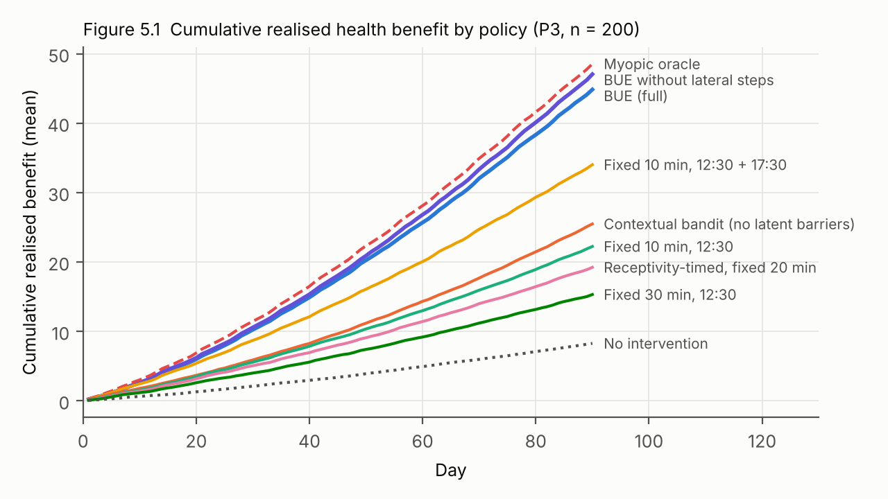
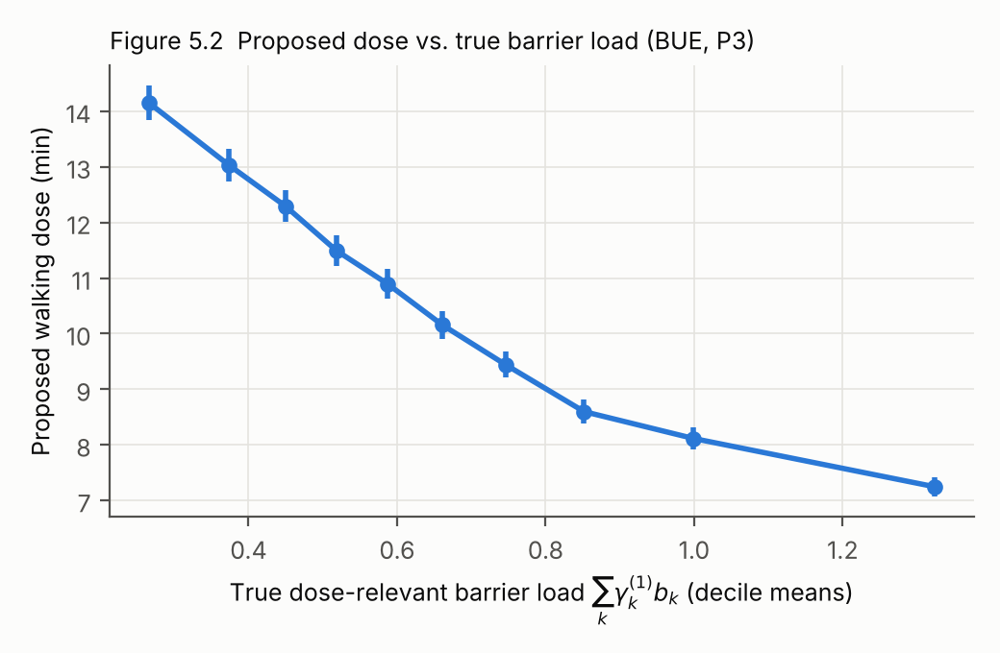
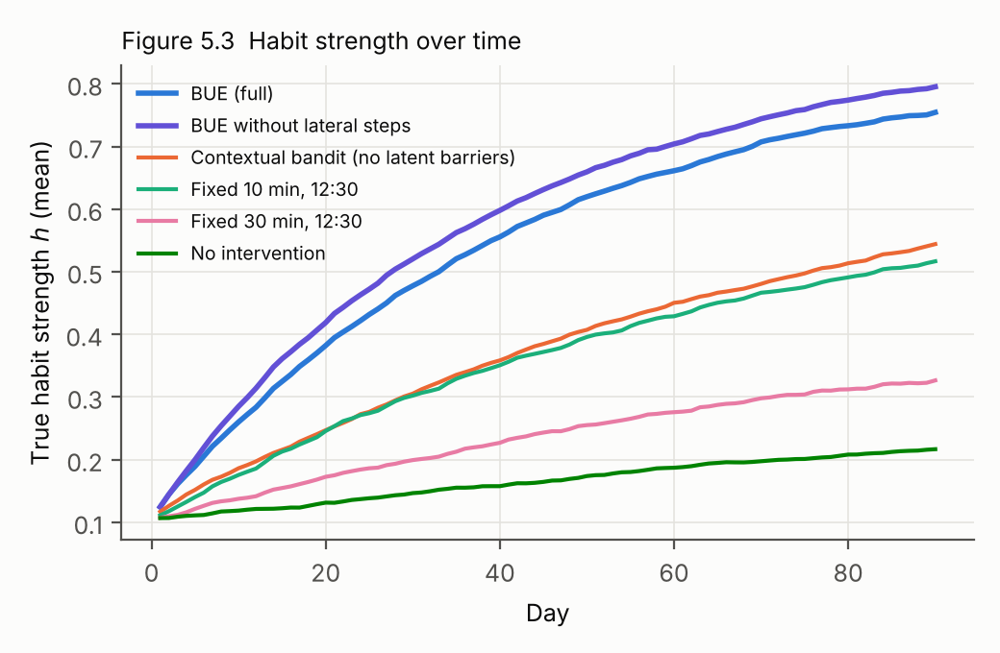
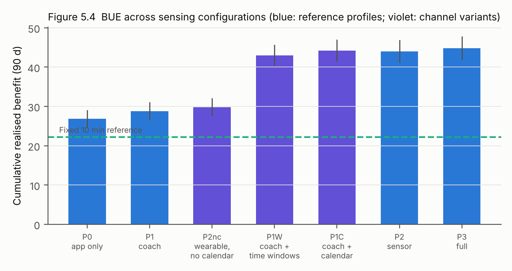
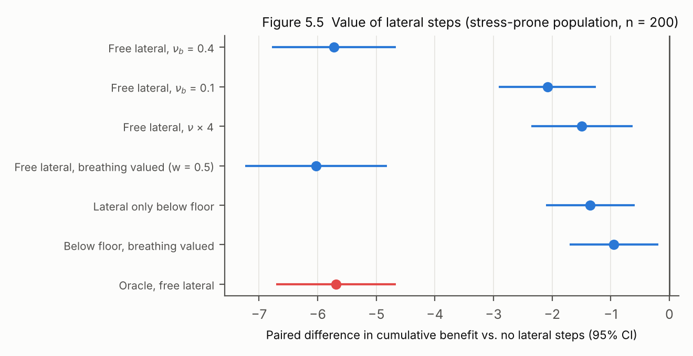

# 5 Evaluation and Simulation Scenarios

This chapter evaluates the Behaviour Understanding Engine against the hypotheses formulated in Section 1.3.2 and the acceptance criteria of Table 3.1. A full empirical evaluation requires a field study, which lies beyond the scope of this thesis. The evaluation therefore has two parts. Sections 5.1–5.6 report an *in-silico* study: the generative model of Chapter 4 is run forward to produce a population of synthetic persons, and the engine and a set of baseline policies are applied to them. The ground truth is known, so properties that cannot be observed in the field become measurable, among them the accuracy of barrier inference and the regret relative to an oracle. Section 5.7 specifies the micro-randomised trial through which the central claims should be tested empirically, and Section 5.8 discusses the threats to validity of both parts.

## 5.1 Evaluation Strategy

Simulation studies are an established step in the development of adaptive interventions and of reinforcement-learning algorithms for mobile health. They are used to stress-test design decisions, to tune hyperparameters and to anticipate failure modes before an algorithm is exposed to participants (Liao et al., 2020; Trella et al., 2025). Their value depends on two conditions. First, the simulated environment must reproduce the phenomena that matter for the decisions under study. Second, the results must be interpreted in light of how the environment was constructed. The second condition is particularly important here. The simulator is built from the same generative model that the engine assumes, so the engine operates in a *well-specified* world, and the study cannot show that the model is true. What it can show is narrower but still substantive:

1. **Internal validity of the engine.** Do the inference and decision algorithms of Chapter 4 actually achieve what the theory of Chapter 3 says they should when the model is correct? This covers calibrated beliefs, the monotone smallest-step behaviour of Proposition 3.2, progression, and performance close to an oracle that knows the truth.
2. **Value of the design elements.** By ablation and comparison, how much does each element contribute — latent barriers, dose adaptation, lateral steps, the execution floor, individual data channels? Answering this requires the ground truth that only a simulation provides.
3. **Sensitivity and robustness.** How do the results depend on design parameters such as $p_{\min}$, and on deviations of the true persons from the engine's assumptions? Volatility is the deviation examined here.

Each research question of Section 1.3.3 that concerns performance (RQ4) and each hypothesis is mapped onto one or more simulation scenarios (Table 5.1). Section 5.8 returns to the limits of what a well-specified simulation can establish.

**Table 5.1.** Mapping of hypotheses and acceptance criteria to scenarios.

| Hypothesis / criterion | Question | Scenario | Primary measure |
|---|---|---|---|
| H0, FR4 | Does EHG maximisation with latent barriers outperform established policies? | S1 main comparison | Cumulative realised benefit |
| H1, FR1 | Are barrier beliefs calibrated, and do latent barriers improve execution prediction? | S1, S2 | Interval coverage; log-loss, calibration slope, AUC |
| H2, FR5 | Does dose adaptation (SSS) increase benefit relative to fixed doses? | S1, S3 | Benefit; dose–barrier relation; execution per prompt |
| H3, FR2 | Does a structured model learn from outcomes better than a flat contextual model? | S1, S2 | Predictive performance over time |
| FR6 | When do lateral steps add value? | S4 | Benefit with/without lateral steps |
| FR9 | Does the engine progress doses as habits strengthen? | S1 | Dose trajectory, habit strength |
| FR11 | How does performance depend on the sensing configuration? | S2 | Benefit by profile |
| — | How sensitive is the engine to $p_{\min}$? | S3 | Benefit, execution per prompt |

## 5.2 A Generative Simulation Environment with Synthetic Personas

### 5.2.1 Structure

The environment is a forward implementation of the joint distribution of Equation (4.1). Its implementation is provided as `simulation/bue_sim.py`. To keep the study tractable and transparent, the reference model is reduced in four ways, each of which narrows the scope of the conclusions rather than biasing them in the engine's favour:

- **Barriers.** Four of the six barriers of the ontology are simulated: physical fatigue, cognitive–affective load, time pressure and low motivation. Environmental and social constraints are omitted. Structural feasibility $\Phi_t$ is simulated explicitly through calendar windows and unscheduled demand.
- **Action space.** The focal class is walking, with the ladder $\{2, 5, 10, 20, 30\}$ minutes. The lateral class is slow breathing, with $\{1, 3, 5, 10\}$ minutes. Together with the null action, this gives ten actions. Preparatory actions and the delivery bandit are not simulated.
- **Time.** Each simulated person lives for 90 days with four decision points per day, at 08:00, 12:30, 17:30 and 20:30. The morning decision point coincides with the daily touchpoint.
- **Learning states.** Habit strength and self-efficacy evolve according to Equations (3.7) and (3.8). The meta-habit is omitted, which is equivalent to a true transfer coefficient $\zeta_m = 0$, the neutral prior of Table 4.1.

The simulated day proceeds as follows. Each morning, the night's sleep and the day's meeting density are drawn. Meeting density is high on weekdays and scaled by the person's busyness, and low at weekends. Sleep drives the fatigue baseline, and meeting density drives the baselines of load and time pressure. Free windows at each decision point are exponentially distributed with a mean that decreases with meeting density, and the actual time available is the window minus an unscheduled demand drawn from a Gamma distribution with a mean of five minutes. Between decision points, barrier logits follow the Ornstein–Uhlenbeck dynamics of Equation (3.20), and receptivity follows Equation (3.21) with a short-memory residual. When a prompt is delivered, the person attends to it with probability $\rho_t$. If attended, the person executes it when the window suffices and with probability $\tilde\pi_a$ (Equation 3.3). Independently, the person may walk spontaneously for 15 minutes with the probability of Equation (4.18), which increases with habit strength and is reduced by crowding-out ($\varpi^\downarrow = 0.25$ for walking proposals shorter than the spontaneous dose, $\varpi^\rightarrow = 0.10$ for lateral proposals). An executed breathing exercise reduces the person's load logit by the person's true efficacy $\eta$. At the end of each day, habit strength grows if the person walked and decays otherwise.

### 5.2.2 Synthetic Personas

Persons are drawn from a population distribution whose parameters correspond to the centres and widths of the prior in Table 4.1. Table 5.2 lists the main sources of heterogeneity. Two features ensure that the population is diverse in the respects that matter for the hypotheses. First, half of the persons are *volatile*: their barrier innovations are twice as large as those of *stable* persons. The engine assumes the population volatility, so it is misspecified for both groups — it overestimates volatility for stable persons and underestimates it for volatile ones. Second, 70% of persons are *responders* to slow breathing, with a load reduction of about 0.8 logit units, and 30% are non-responders. A separate *stress-prone* population with elevated load baselines and strong breathing responses is used for scenario S4.

**Table 5.2.** Heterogeneity in the synthetic population (natural scale; LN = log-normal).

| Quantity | Distribution | Interpretation |
|---|---|---|
| Barrier baselines $\mu_k$ (logit) | $\mathcal{N}((-1.0, -1.0, -1.2, -1.0), 0.5^2)$ | Typical barrier levels, ≈ 0.27 on the probability scale |
| Busyness | $\mathcal{U}(0.2, 0.9)$ | Scales weekday meeting density |
| Sleep | mean $\mathcal{N}(7, 0.5^2)$ h, day-to-day SD $\mathcal{U}(0.5, 1.2)$ h | Driver of fatigue |
| Volatility | stable (0.8×) or volatile (1.6×) population innovation SD, 50/50 | Day-to-day unpredictability |
| Propensity $\alpha$ | $\mathcal{N}(1.8, 0.5^2)$ | Baseline willingness to act |
| Barrier sensitivities $\gamma^{(0)}, \gamma^{(1)}$ (walking) | LN around $(0.5, 0.4, 0.3, 0.8)$ and $(0.8, 0.3, 1.0, 0.2)$, log-SD 0.4 | Fatigue and time pressure interact strongly with dose |
| Breathing efficacy $\eta$ | 70%: LN(0.8, 0.3); 30%: 0.05 | Responders vs non-responders |
| Receptivity intercept | $\mathcal{N}(0.6, 0.5^2)$ | Average attention to prompts |
| Spontaneous walking $\alpha^{\text{sp}}$ | $\mathcal{N}(-3.2, 0.5^2)$ | Rare without habit; frequent with strong habit |
| Initial habit, self-efficacy | $\mathcal{U}(0, 0.2)$, $\mathcal{U}(0.3, 0.6)$ | Beginners with moderate confidence |

### 5.2.3 Observations by Sensing Profile

The simulated channels follow Section 3.6 and depend on the sensing profile (Section 3.2.4):

- **Wearable and phone (P2, P3).** Each morning they provide last night's sleep, which acts as a driver, and nocturnal HRV, modelled as evidence loading on fatigue and load with noise SD 0.7. At each decision point they provide phone fragmentation, which is evidence of load, and a noisy observation of the receptivity residual. Walking is verified by accelerometer with sensitivity 0.90, and the accelerometer cannot distinguish prompted from spontaneous walks.
- **Calendar (P2, P3).** Each morning it provides the day's meeting density, a driver, and the free windows, from which $\Phi_t$ is computed with Equation (3.27).
- **Touchpoint (P1, P3).** Each morning it provides single-item ratings of energy, stress, time pressure and motivation, each with noise SD 0.15 on the unit scale. In P3, the two items with the largest posterior variance are asked, as a proxy for the value-of-information selection of Equation (3.29). Without calendar access, P1 also includes a coarse time-pressure question with three categories. Confirmations of executed proposals are given with probability 0.85.
- **App only (P0).** Only engagement and one-tap confirmations, given with probability 0.70, are observed.

Two further configurations isolate individual channels for scenario S2: touchpoint plus calendar (P1C), and wearable plus phone without calendar (P2nc). A third, P1W, replaces P1's coarse time question with a question about free time per day period ("less than 10 / 10–20 / more than 20 minutes around lunch, afternoon, evening?").

### 5.2.4 The Engine in the Simulation

The engine is implemented as specified in Chapter 4, with three simplifications that are standard in simulation studies and are stated here explicitly:

- The nightly Laplace update is replaced by a static-parameter particle filter with Liu–West rejuvenation over the whole horizon. Each user has $N = 600$ particles, and each particle carries 27 learned parameters: intercepts, dose sensitivities, eight barrier sensitivities per class, barrier baselines, the receptivity intercept, the breathing efficacy and the spontaneous-behaviour intercept.
- The dynamics constants $T_k$ and the driver coefficients are set to their population values.
- Value-of-information item selection is approximated by posterior variance.

All other components are implemented as specified:

- the Expected Health Gain net of spontaneous behaviour (Equations 4.17 and 4.19–4.20);
- the chance-constrained floor with $p_{\min} = 0.5$ and $\varepsilon_p = 0.2$ (Equation 4.23);
- the progression cap (Equation 4.27);
- the focus constraint, with at least four focal proposals per seven days while $h < 0.6$ (Equation 3.19);
- a cap of two prompts per day;
- Thompson sampling with clipping of the prompt probability to $[0.1, 0.9]$.

The marginal values take the calibrated reference values $\nu_h = 1.8$ (Equation 4.28), $\nu_e = 1.5$ and $\nu_b = 0.4$.

### 5.2.5 Outcome Measure

The primary outcome is the **cumulative realised health benefit** over 90 days: the sum of the immediate dose–response values $b^{\text{imm}}$ (Equation 3.6) of all executed actions, prompted and spontaneous. It deliberately *excludes* the shaped terms of the engine's objective, namely the habit, self-efficacy and barrier-reduction values. Those terms are decision aids that the engine uses to anticipate the future. The future itself is simulated, and its benefits are counted when they are realised. An engine whose value shaping were miscalibrated would therefore be penalised by this outcome rather than rewarded by it. The benefit of a 30-minute walk is 0.88 units, so a cumulative benefit of 45 corresponds roughly to the health value of fifty 30-minute walks over the 90 days.

## 5.3 Baseline Policies

The engine is compared against seven policies. They represent the current practice of digital interventions, the state of the art in adaptive interventions, and two reference points (Table 5.3). All policies act on the same simulated persons. Personas, exogenous days and the random numbers that govern outcomes are shared across policies (common random numbers), so differences between policies are estimated as *paired* differences per person, which removes most of the between-person variance.

**Table 5.3.** Policies compared.

| Policy | Description | Represents |
|---|---|---|
| **No intervention** | No prompts; only spontaneous behaviour | Counterfactual baseline |
| **Fixed 30 min** | Daily prompt at 12:30 for a 30-minute walk | Guideline-oriented goal–reminder app |
| **Fixed 10 min** | Daily prompt at 12:30 for a 10-minute walk | Moderate fixed target |
| **Fixed 10 min ×2** | Prompts at 12:30 and 17:30 for a 10-minute walk | Controls for prompt frequency (same cap as the engine) |
| **Receptivity-timed 20 min** | One daily prompt for a 20-minute walk, at the decision point with the highest *true* receptivity | Receptivity-optimised timing with fixed content, with ideal receptivity knowledge (cf. Mishra et al., 2021) |
| **Contextual bandit** | Thompson sampling over all ten actions with a Bayesian logistic model of execution on the *observed* features of the profile (sleep, HRV, meeting density, self-report, time of day) and their interactions with dose. Same value shaping, floor, progression cap, prompt cap and clipping as the engine | State-of-the-art adaptive algorithm without latent barriers (cf. Section 2.9.3) |
| **BUE without lateral steps** | The engine restricted to the focal class | Ablation of cross-domain substitution |
| **Myopic oracle** | Knows true states and parameters; maximises the same one-step objective as the engine without exploration | Upper reference for what the engine's objective can achieve with perfect knowledge |

Two remarks on the reference policies. The receptivity-timed baseline is deliberately generous: it uses the *true* receptivity, so it represents the best that perfect timing with fixed content can achieve. The myopic oracle is not a global optimum. It maximises the engine's one-step objective with perfect information, so it is the right reference for the quality of the engine's *inference and learning*. It can, however, be outperformed by a policy that happens to value the future more accurately — a point that becomes relevant in Section 5.6.5.

## 5.4 Outcome Metrics

The primary metric and its rationale were given in Section 5.2.5. The secondary metrics are:

- **Behaviour.** Walking minutes per week in weeks 10–13, prompted and spontaneous; the proportion of days with at least one health action; and final habit strength $h$, which is the simulation's measure of "change that sticks".
- **Prompting.** Prompts per day, engagement rate per prompt and execution rate per prompt. The last is the empirical counterpart of the floor's purpose: few failed proposals.
- **Inference (H1, H3).** The log-loss of the predicted execution probability for each prompt, evaluated against the true execution; the logistic *calibration slope*, which is 1 for a calibrated model and below 1 for an over-confident one; the area under the ROC curve (AUC); and, for the engine, the empirical coverage of 80% posterior credible intervals for the true barrier intensities.
- **Smallest step behaviour (H2, Proposition 3.2).** The relation between the proposed walking dose and the true dose-relevant barrier load $\sum_k \gamma^{(1)}_k b_{k,t}$, pooled and within persons, and the dose trajectory over time.

All results are reported as means over $n = 200$ synthetic persons per condition with 95% confidence intervals. Comparisons are reported as paired differences.

## 5.5 Scenarios

Five scenarios address the questions of Table 5.1.

- **S1 — Main comparison.** All policies in the full sensing profile P3 on the general population.
- **S2 — Sensing configurations.** The engine and the contextual bandit in profiles P0, P1, P2 and P3, complemented by the channel-isolating configurations P1C, P2nc and P1W (Section 5.2.3). This scenario answers the question raised in Section 3.2.4: how much does each way of knowing the person contribute — asking or observing, and which channel?
- **S3 — Execution floor.** The engine with $p_{\min} \in \{0, 0.3, 0.5, 0.7\}$.
- **S4 — Lateral steps.** The engine and the oracle, each with and without lateral steps, in the general population and in the stress-prone population. These are crossed with two health weights for slow breathing ($w = 0.15$, where breathing has little direct value for a user whose goal is activity, and $w = 0.5$, where the user values stress regulation in its own right) and with the value-shaping scale of Section 4.8.3.
- **S5 — Calibration of the marginal values.** The engine with the value-shaping multiplier $\nu \in \{0.5, 1, 2, 4\}$ applied to $\nu_h$, $\nu_e$ and $\ell$. This implements the simulation-based calibration step of Section 4.8.3.

Subgroup analyses by volatility and busyness are reported for S1.

## 5.6 Results

All results refer to $n = 200$ synthetic persons per condition, followed for 90 days. Values are means with 95% confidence intervals; comparisons between policies are paired differences on the same persons. The full output of the analysis script is provided as `simulation/results_summary.md`.

### 5.6.1 Main Comparison (H0)

Table 5.4 and Figure 5.1 summarise scenario S1. The engine more than doubled the cumulative realised benefit of the best single-prompt fixed schedule (44.8 vs 22.2; paired difference 22.6 ± 1.8, +102%). It exceeded the benefit of a fixed 30-minute target almost threefold, and that of the contextual bandit by 76% (paired difference 19.4 ± 2.1, better for 92% of persons). The comparison with the twice-daily fixed schedule, which prompts as often as the engine, isolates the contribution of *what* and *when* from that of *how often*. The engine's advantage shrank to 32% (10.8 ± 1.3) but remained clear, and it was better for 88% of persons. The engine achieved 92% of the myopic oracle's benefit. Its variant without lateral steps achieved 97% (47.1 vs 48.5).

**Table 5.4.** Main comparison (scenario S1, sensing profile P3).

| Policy | Cum. benefit (90 d) | Walking min/week (wk 10–13) | Prompts/day | Engagement | Execution/prompt | Days with ≥ 1 action | Final habit $h$ |
|---|---|---|---|---|---|---|---|
| No intervention | 8.3 ± 1.2 | 18.0 ± 3.3 | 0 | – | – | 13% | 0.22 ± 0.02 |
| Fixed 30 min | 15.3 ± 1.7 | 38.0 ± 4.9 | 1.00 | 61% | 7% | 21% | 0.33 ± 0.02 |
| Fixed 10 min | 22.2 ± 1.8 | 47.5 ± 4.5 | 1.00 | 62% | 23% | 37% | 0.52 ± 0.03 |
| Fixed 10 min ×2 | 34.0 ± 2.2 | 69.5 ± 5.0 | 2.00 | 60% | 23% | 52% | 0.66 ± 0.03 |
| Receptivity-timed 20 min | 19.2 ± 1.9 | 44.4 ± 5.0 | 1.00 | 61% | 12% | 27% | 0.40 ± 0.03 |
| Contextual bandit | 25.5 ± 2.4 | 54.7 ± 6.8 | 1.34 | 57% | 40% | 55% | 0.54 ± 0.04 |
| BUE without lateral steps | 47.1 ± 2.8 | 112.3 ± 7.8 | 1.81 | 56% | 37% | 68% | 0.80 ± 0.02 |
| **BUE (full)** | **44.8 ± 3.0** | **104.6 ± 8.2** | 1.86 | 56% | 37% | 68% | 0.75 ± 0.02 |
| Myopic oracle | 48.5 ± 3.1 | 116.0 ± 8.5 | 1.88 | 56% | 37% | 68% | 0.76 ± 0.02 |

**Figure 5.1.** Cumulative realised health benefit by policy. The curves of the engine and the oracle steepen over time: the habit they build produces increasing spontaneous behaviour.

Four observations stand out.

First, **ambitious fixed targets fail mostly by not being executed**. Only 7% of the 30-minute prompts were executed, although 61% were attended to. This is the failure mode described in Section 1.2, reproduced in silico.

Second, **perfect timing does not compensate for fixed content**. The receptivity-timed baseline knew the true receptivity and still executed only 12% of its 20-minute proposals. It ended below the fixed 10-minute schedule, which had no timing intelligence at all. Receptivity determines whether a prompt is *seen*; whether it is *done* depends on the size of the request relative to the day's barriers. This is precisely the division of labour of Proposition 3.3.

Third, the engine's advantage **grows over time**. The curves in Figure 5.1 diverge, because the engine's consistent small successes build habit: final habit strength 0.75–0.80 versus 0.52 for the fixed 10-minute schedule. Habit in turn produces spontaneous walking that no longer requires prompts. In weeks 10–13, persons supported by the engine walked 105–112 minutes per week, compared with 48 minutes under the fixed 10-minute schedule and 18 minutes without intervention.

Fourth, the engine was active on **68% of days** — at least one health action — compared with 37% and 52% for the single and twice-daily fixed schedules. This is the "smallest step that still happens" in aggregate.

### 5.6.2 Smallest-Step Behaviour and Progression (H2)

Proposition 3.2 predicts that the optimal dose falls as the dose-relevant barrier load rises. Figure 5.2 shows that the engine's proposals followed this prediction against the *true* barrier load, which the engine never observed directly. Across load deciles, the mean proposed walking dose fell monotonically from 14.1 to 7.2 minutes. The pooled correlation between true load and proposed dose was $r = -0.28$. The mean within-person correlation was $r = -0.23$ and was negative for 96% of persons, so the relation holds within persons and is not an artefact of between-person differences.

**Figure 5.2.** Mean proposed walking dose by decile of true dose-relevant barrier load, $\sum_k \gamma^{(1)}_k b_{k,t}$ (error bars: 95% CI).

At the same time, doses **progressed** as habits consolidated (Corollary 4.1, Equation 4.27). The mean proposed walking dose rose from 7.9 minutes in the first month to 11.1 and 12.4 minutes in the second and third. Figure 5.3 shows the corresponding growth of habit strength. The engine thus produced both movements of the Smallest Step Strategy: down on hard days, up over weeks.

**Figure 5.3.** Mean true habit strength over time.

The execution floor (scenario S3, Table 5.5) behaved as intended. Raising $p_{\min}$ from 0 to 0.5 left cumulative benefit unchanged (44.8 in both cases) but raised the execution rate per prompt from 32% to 37%. It also slightly increased final habit strength, because fewer failures eroded self-efficacy. The floor therefore removes failures *at no cost in benefit*, which is its purpose. At $p_{\min} = 0.7$, the floor excluded too many useful proposals, and benefit fell by 29% to 31.8. The reference value of 0.5 lies at the upper end of the safe range.

**Table 5.5.** Sensitivity to the execution floor (scenario S3).

| $p_{\min}$ | Cum. benefit | Prompts/day | Execution/prompt | Final $h$ |
|---|---|---|---|---|
| 0 | 44.8 ± 2.9 | 1.92 | 32% | 0.73 ± 0.02 |
| 0.3 | 45.0 ± 3.0 | 1.90 | 33% | 0.73 ± 0.02 |
| **0.5** | **44.8 ± 3.0** | 1.86 | 37% | 0.75 ± 0.02 |
| 0.7 | 31.8 ± 2.9 | 1.35 | 41% | 0.65 ± 0.03 |

### 5.6.3 Inference and Learning (H1, H3)

Table 5.6 reports how well the engine and the contextual bandit predicted the execution of their own proposals. Two reference points frame the numbers:

- the *base-rate* log-loss, obtained by always predicting the average execution rate;
- the *true-probability* log-loss, obtained by predicting with the simulator's true execution probability. This is the irreducible limit, given that execution remains a chance event even when its probability is known.

In profile P3, the engine's log-loss over the last month (0.635) was below the base rate (0.660) and closed about 40% of the attainable gap to the true-probability limit (0.606). Its predictions were well calibrated: the calibration slope was 0.85–1.07 across profiles. The contextual bandit's log-loss was *above* its base rate in every profile, and its calibration slope of 0.31–0.61 indicates strong over-confidence. Its AUC was also lower (0.56–0.57 vs 0.58–0.63). The modest absolute discrimination of both models — an AUC of around 0.6 — is not a weakness of the models but a property of the problem: whether an attended prompt is executed depends on unobserved momentary factors that no model can predict. The relevant comparison is with the attainable limit, against which the engine performs well and the flat model poorly.

**Table 5.6.** Prediction of execution (log-loss; lower is better).

| Model | Days 1–30 | Days 31–60 | Days 61–90 | Base rate | True probability | AUC | Calibration slope |
|---|---|---|---|---|---|---|---|
| BUE, P3 | 0.643 | 0.641 | 0.635 | 0.660 | 0.606 | 0.620 | 0.92 |
| Contextual bandit, P3 | 0.703 | 0.685 | 0.688 | 0.680 | 0.614 | 0.568 | 0.35 |
| BUE, P2 | 0.645 | 0.639 | 0.638 | 0.664 | – | 0.625 | 0.99 |
| Contextual bandit, P2 | 0.704 | 0.688 | 0.690 | 0.679 | – | 0.558 | 0.31 |
| BUE, P1 | 0.632 | 0.626 | 0.630 | 0.636 | – | 0.575 | 0.85 |
| Contextual bandit, P1 | 0.644 | 0.656 | 0.682 | 0.655 | – | 0.559 | 0.61 |
| BUE, P0 | 0.629 | 0.629 | 0.633 | 0.643 | – | 0.598 | 1.07 |
| Contextual bandit, P0 | 0.640 | 0.684 | 0.719 | 0.654 | – | 0.559 | 0.59 |

The contextual bandit's poor calibration illustrates the mechanism behind H3. A flat model must learn the interaction of every observed feature with every dose from its own outcomes. With roughly 1.3 prompts per day, it does not have enough data to do so within 90 days, and its posterior concentrates too early on spurious patterns. The engine needs to learn only a few person-level sensitivities, and it receives prior structure — which barrier acts on which dose dimension, and how evidence relates to barriers — as part of its model.

Barrier inference itself was reasonably but imperfectly calibrated. The empirical coverage of nominal 80% credible intervals in P3 was 75% for fatigue, 78% for load, 67% for time pressure and 58% for motivation. The under-coverage is consistent with the deliberately misspecified volatility (Section 5.2.2). It is largest for motivation, the barrier with the weakest evidential anchor (Section 3.6.8), which is a direct empirical confirmation of the identifiability analysis of Section 3.4.8. Notably, coverage for motivation was better in P0 and P1 (75%), where the engine had less evidence and therefore wider intervals. The over-confidence arises from combining many weak evidence sources under a misspecified volatility, not from evidence scarcity. This suggests inflating the assumed volatility as a cheap remedy (Section 6.6).

### 5.6.4 Sensing Configurations (FR11)

Scenario S2 asked how much each way of knowing the person contributes (Table 5.7, Figure 5.4). The engine outperformed the fixed 10-minute schedule in *every* configuration, including app only (P0: 26.9 vs 22.2), so channel agnosticism holds. The configurations, however, fell into two clear groups:

- **Without information about free time:** P0, P1 and P2nc reached 27–30.
- **With information about free time:** P1W, P1C, P2 and P3 reached 43–45, from the calendar or from a touchpoint question about time windows.

**Table 5.7.** Cumulative benefit by sensing configuration (scenario S2).

| Configuration | Channels | BUE | Contextual bandit |
|---|---|---|---|
| P0 | App only | 26.9 ± 2.2 | 11.1 ± 1.5 |
| P1 | Touchpoint, coarse time question | 28.8 ± 2.3 | 13.6 ± 1.7 |
| P2nc | Wearable and phone, no calendar | 29.8 ± 2.3 | – |
| P1W | Touchpoint with free-window question | 43.0 ± 2.7 | – |
| P1C | Touchpoint and calendar | 44.2 ± 2.9 | – |
| P2 | Wearable, phone, calendar | 44.0 ± 2.9 | 26.8 ± 2.7 |
| P3 | All channels | 44.8 ± 3.0 | 25.5 ± 2.4 |

**Figure 5.4.** Cumulative benefit of the engine across sensing configurations.

The decisive information was therefore knowledge of *opportunity* — when the person has time and how much — rather than physiological state. Two results are particularly relevant for the design of the product.

First, a coach-style touchpoint that asks *"How much time do you have around lunch, in the afternoon, in the evening?"* recovered 96% of the benefit of full sensing (P1W: 43.0 vs 44.8), without any wearable or calendar access. This supports the decision of Section 3.2.4 to treat the daily conversation as a first-class alternative to sensing. It also identifies the time-window question as the single most valuable item in the touchpoint.

Second, wearable and phone sensing without the calendar added little over app-only operation (P2nc: 29.8 vs 26.9). In the simulated world, physiological signals inform fatigue and load, but these matter less for the decision than whether a window exists at all. Whether this holds in reality depends on the true relative strength of barriers. It is a central question for the trial of Section 5.7, and it is one that the engine's logs can answer.

### 5.6.5 Lateral Steps (FR6)

Scenario S4 produced the most instructive result of the study, and it is a negative one. In the general population, free lateral steps *reduced* cumulative benefit (paired difference −2.2 ± 0.9). In the stress-prone population, where the theory of Section 3.3.7 predicts that they are most useful, they reduced it by −5.7 ± 1.1 (Figure 5.5, Table 5.8). The myopic oracle, which knows each person's true breathing efficacy, lost exactly as much (−5.7). The loss is therefore not a failure of inference. It is a property of the one-step objective.

**Table 5.8.** Lateral steps in the stress-prone population (scenario S4).

| Variant | Cum. benefit | Lateral share | Walking min/week | Final $h$ | Paired diff. vs. no lateral |
|---|---|---|---|---|---|
| BUE without lateral steps | 41.7 ± 2.7 | 0% | 97.6 | 0.77 | – |
| Free lateral ($\nu_b = 0.4$) | 36.0 ± 2.7 | 23% | 82.2 | 0.68 | −5.7 ± 1.1 |
| Free lateral, $\nu_b = 0.1$ | 39.6 ± 2.7 | 7% | 91.4 | 0.74 | −2.1 ± 0.8 |
| Free lateral, $\nu \times 4$ | 39.8 ± 2.7 | 7% | 90.9 | 0.75 | −1.5 ± 0.9 |
| Free lateral, breathing valued ($w = 0.5$) | 35.7 ± 2.1 | 66% | 41.7 | 0.47 | −6.0 ± 1.2 |
| Lateral only below ladder floor | 40.3 ± 2.6 | 4% | 94.0 | 0.76 | −1.35 ± 0.76 |
| Below floor, breathing valued ($w = 0.5$) | 40.7 ± 2.6 | 5% | 93.4 | 0.76 | −0.95 ± 0.76 |
| Myopic oracle, free lateral | 39.0 ± 2.9 | 33% | 89.7 | 0.66 | −5.7 ± 1.0 |

**Figure 5.5.** Paired difference in cumulative benefit between lateral variants and the engine without lateral steps.

The mechanism is visible in the habit column. Every lateral step occupies a prompt opportunity that would otherwise have produced a small focal repetition. Each forgone repetition slows the growth of walking habit, and a slower habit means fewer spontaneous walks for the rest of the horizon. The one-step objective represents this future only through the marginal value $\nu_h$, and the result shows that the analytical approximation of Equation (4.28) *undervalues* it. Equation (4.28) counts the effect of habit on prompted execution, but in the simulation the larger payoff of habit is unprompted behaviour. The effect is most extreme when breathing has substantial value in its own right ($w = 0.5$). Both the engine and the oracle then shifted most prompts to breathing, which is myopically attractive. Walking fell by more than half, and the cumulative benefit, *including* the higher-valued breathing, was lower than without lateral steps.

Two remedies were effective. Scaling up the long-term values (by a factor of 4) reduced the loss from −5.7 to −1.5. Restricting lateral steps to situations in which no focal step passes the floor — the "below the ladder floor" role identified in Section 3.3.7 — reduced it to −1.35 in the stress-prone population. In the general population, the same restriction reduced it to a statistically non-significant −0.4 ± 0.8, and it gained 4.4 ± 1.1 over free lateral steps. The simulated world contained no transfer from lateral actions to the focal behaviour ($\zeta_m = 0$). Under that condition, the best a lateral step can do is to rescue days on which nothing else would have happened, and this is what the restricted variant does.

The result revises the design recommendation of Section 3.3.7. During habit formation, lateral steps should be offered **only below the floor of the focal ladder**. Free lateral steps should be reserved for the maintenance phase (Section 4.8.4), for users who explicitly choose a holistic mode, or for settings in which a positive transfer coefficient $\zeta_m$ has been established empirically. Whether such transfer exists is exactly what contrast 3 of the proposed trial (Table 5.10) is designed to determine.

### 5.6.6 Calibration of the Long-Term Values (S5)

Scenario S5 implements the simulation-based calibration step of Section 4.8.3. Scaling the marginal values $\nu_h$, $\nu_e$ and the failure cost $\ell$ by a common multiplier changed cumulative benefit monotonically: 44.6 at ×0.5, 44.8 at ×1, 45.3 at ×2 and 46.4 at ×4. The gain came mainly from fewer lateral steps (from 18% of prompts at ×0.5 to 4% at ×4) and from higher final habit strength (0.75 to 0.80). Without lateral steps, the multiplier ×2 reached 47.3. Together with Section 5.6.5, this yields the calibrated configuration for the field trial:

- value multiplier 2–4;
- lateral steps restricted to below the floor during formation;
- $p_{\min} = 0.5$.

The general lesson is methodological. Value shaping in a one-step objective is an approximation that must be tuned against a model of the long run. The simulator is the instrument for this tuning, as anticipated in Section 4.8.3.

### 5.6.7 Subgroups

The engine's gain over the fixed 10-minute schedule was similar for volatile and stable persons (22.1 ± 2.6 vs 23.1 ± 2.5). Its advantage therefore does not depend on the engine's volatility assumption being correct. The gain was somewhat smaller for persons with above-median busyness (20.3 vs 24.9). With few feasible windows, every policy is constrained, and smaller steps can only partly compensate for the absence of time.

### 5.6.8 Summary of Evidence

Table 5.9 relates the findings to the hypotheses and requirements. Within the limits discussed in Section 5.8, the simulation supports the core hypothesis and the mechanisms H1–H3. It supports channel agnosticism and identifies opportunity information as the most valuable input. It also falsifies the original, unrestricted formulation of lateral steps and replaces it with a better-founded rule.

**Table 5.9.** Summary of evidence from the simulation study.

| Claim | Result | Verdict |
|---|---|---|
| H0: EHG with latent barriers beats established policies | +32% to +193% vs. fixed schedules; +76% vs. contextual bandit; 92–97% of oracle | Supported (in silico) |
| H1: latent barriers improve prediction | Engine below base-rate log-loss and calibrated; flat model above base rate and over-confident; barrier coverage 58–78% at nominal 80% | Supported; barrier uncertainty slightly over-confident |
| H2: smallest-step dosing raises execution and benefit | Dose falls with true load within 96% of persons; doses progress over time; floor removes failures at no cost | Supported |
| H3: structured learning from outcomes beats flat learning | Calibration slope 0.85–1.07 vs. 0.31–0.61 at equal data | Supported (model-class comparison) |
| FR6: lateral steps add value | Free lateral steps cost 2–6 units, even for the oracle; restricted to below the floor: neutral | Not supported as originally specified; rule revised |
| FR11: channel agnosticism | Engine beats fixed schedule in all configurations; time-window question recovers 96% of full-sensing benefit | Supported |
| NFR8: on-device feasibility | 2–5 ms per decision (Section 4.9.3) | Supported |

## 5.7 Design of an Empirical Micro-Randomised Validation Trial

The simulation establishes that the engine works as designed *if* people behave as the model assumes. Whether they do is an empirical question. This section specifies a trial to answer it. The engine was built to make such a trial cheap. Its clipped Thompson sampling already randomises at every decision point with logged probabilities (Section 4.7.2), so a deployment of the engine *is* a micro-randomised trial (MRT) once the protected contrasts are specified in advance.

### 5.7.1 Design Overview

The proposed study is a 12-week MRT of the engine in adults who are insufficiently active, recruited without requirements on devices. Participants choose their own sensing profile, P0–P3. Physical activity is the focal behaviour, and slow breathing is available as a lateral class. Four to eight decision points per day are generated as in Section 3.2.3. At each available decision point, the engine's policy is applied with the randomisations listed in Table 5.10. Their probabilities are fixed in advance, by clipping, or determined by the posterior under Thompson sampling. All are logged.

**Table 5.10.** Randomised contrasts and proximal outcomes.

| # | Contrast | Randomisation | Proximal outcome | Hypothesis tested |
|---|---|---|---|---|
| 1 | Prompt vs no prompt | Clipped TS, probability in $[0.1, 0.9]$ | Step count in the 60 min after the decision point | Overall proximal effect; moderation by inferred barrier load and receptivity (receptivity hypothesis) |
| 2 | EHG-selected dose vs fixed reference dose (20 min) | 0.5 at decision points where the two differ | Execution of the proposed behaviour; minutes walked in 90 min | H2: smallest-step dosing increases execution and realised minutes on high-barrier occasions |
| 3 | Downward vs lateral step | Clipped, $[0.2, 0.8]$, when both are admissible | Focal execution within 24 h; next-day load estimate | Transfer vs licensing of lateral steps (Section 3.3.7) |
| 4 | Touchpoint plan with vs without fallback step | 0.5 per day (P1, P3) | Any focal execution that day | Value of pre-agreed fallback (implementation intention) |
| 5 | Ambient cue device vs. phone notification (device owners only) | 0.5 per prompt | Engagement within 30 min; confirmation rate; execution | Peripheral cueing raises receptivity and verification (Section 3.8.4) |
| 6 | Motive-matched vs. generic framing of the same action | 0.5 per prompt | Engagement; execution; post-execution affect | Motive–incentive fit (Section 3.4.11); moderation by the motive profile |

### 5.7.2 Primary Analyses

The primary estimands are causal excursion effects (Equations 2.1–2.2). They are estimated with the weighted and centred least-squares estimator for continuous proximal outcomes (Boruvka et al., 2018) and its binary-outcome counterpart on the log relative-risk scale (Qian et al., 2021).

- **Receptivity hypothesis.** The proximal effect of a prompt (contrast 1) is moderated by the engine's posterior barrier load and by its receptivity estimate. The moderator coefficients are expected to be negative for load and positive for receptivity.
- **H2.** On decision points in the upper tercile of inferred barrier load, the EHG-selected dose produces higher execution and higher realised walking minutes than the fixed reference dose (contrast 2).
- **H3 and H1.** Out-of-sample prediction of execution by the engine's model, assessed prospectively by log-loss and calibration, is compared with a pre-registered contextual model without latent barriers that is fitted to the same data.
- **Lateral steps.** The excursion effect of a lateral relative to a downward step on focal execution within 24 hours (contrast 3) is estimated. It distinguishes transfer (positive), neutrality and licensing (negative).

### 5.7.3 Sample Size

The sample size of MRTs is driven by the number of decision points per participant and by the size of the proximal effects, rather than by the number of participants alone. It is determined with the method of Liao et al. (2016), which accounts for availability, the randomisation probability and the trajectory of the effect over the study. For orientation: HeartSteps detected a proximal effect on step counts with 37 participants over six weeks (Klasnja et al., 2019). The moderation and contrast analyses of Table 5.10 are more demanding, and contrasts 2 and 3 apply only to a subset of decision points. A sample of about 80–120 participants over 12 weeks is therefore a realistic planning range, to be confirmed by a formal power analysis using effect sizes from a pilot phase.

### 5.7.4 Distal Evaluation and Ethics

An MRT optimises and explains the components of an intervention. It does not establish the intervention's effect relative to standard care. A subsequent two-arm randomised controlled trial is therefore required. It would compare the engine with a conventional goal-and-reminder app on device-measured weekly activity at 6 and 12 months, with habit strength (SRBAI) and attrition as secondary outcomes. A factorial extension of this trial can randomise the engagement elements of Section 3.8 between persons: accumulated-gain display (on/off) and forgiving consistency streak (on/off). The elicited motive profile is analysed as a pre-registered moderator of these effects. This tests whether the engagement elements add to the engine's effect without creating failure experiences, measured for example by perceived autonomy support and self-reported frustration. Both studies require ethical approval, pre-registration of hypotheses and analysis plans, and a data-protection impact assessment, given the special-category data involved (Section 3.7.3). Participants must be informed that the timing and content of support are partly randomised.

## 5.8 Threats to Validity

**Well-specified simulation.** The most important limitation of Sections 5.2–5.6 is that the engine's model and the simulator share their structure. The engine knows the functional forms, the evidence model and the dynamics. It learns only the person-specific values, and for the time constants and driver effects it assumes population values. Its performance is therefore an upper bound on what can be expected when people deviate from the model. The volatility misspecification in the population is a first step towards robustness testing, but structural misspecification has not been tested. Examples are a non-logistic link, barriers that are absent from the ontology, and evidence channels that relate non-linearly to barriers. Such tests are a priority for future work (Section 6.6).

**Construction of the baselines.** The contextual bandit was given the same value shaping, floor, progression cap and prompt cap as the engine. Its disadvantage therefore stems from the absence of latent structure and of an explicit two-stage outcome model, not from a weaker objective. However, only one flat model specification was tested. Richer feature engineering or non-linear models, such as tree ensembles or neural networks, might narrow the gap, at the price of interpretability and data efficiency.

**Outcome metric.** The realised benefit uses the same dose–response function that the engine assumes. If the true health value of small doses is lower than Equation (3.6) implies, the advantage of small steps is overstated. Conversely, it is understated if very small doses carry health benefits beyond their immediate dose–response value.

**Behavioural assumptions.** The simulated persons do not disengage from the app. Attrition is the dominant failure mode of real mHealth interventions (Section 2.5.2), and policies that prompt more could suffer more from it. The engine prompts about twice a day; the fixed-schedule baselines prompt once. The comparison with the twice-daily fixed policy controls for prompt frequency in the simulation, but not for its long-term effect on engagement.

**External validity.** The parameters of the synthetic population were derived from the literature-based priors of Table 4.1, not estimated from real data. The absolute numbers — for example, walking minutes per week — should therefore not be read as predictions. The *relative* findings, such as which design elements matter and which channel carries the most information, are the robust contribution of the simulation, and they define precisely what the trial of Section 5.7 must confirm.
